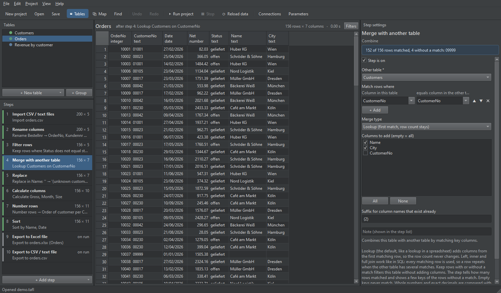
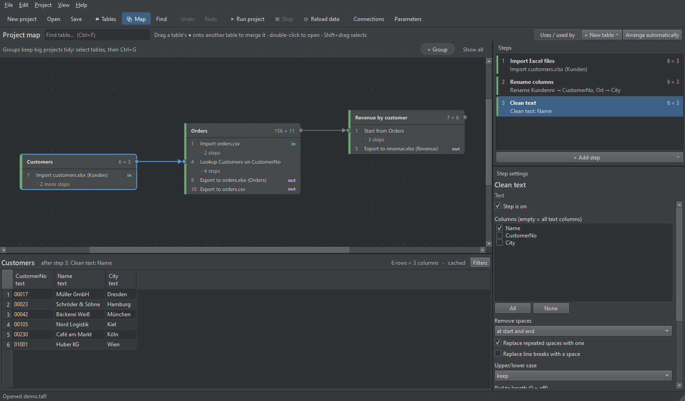

# Tafl

A desktop app for preparing data. A table is built step by step (import → transform → export),
and the data after every step is right there to look at. Projects are saved as `*.tafl` files
and can also be run from the command line, e.g. by the Windows Task Scheduler. *Tafl* is Old Norse
for "table".



- **Import** CSV / text files, Excel workbooks and Parquet files (one file or all files of a
  folder), SQL Server and SQLite tables or queries.
- **Transform** with steps: filter, sort, remove duplicates, fill empty values, rename and
  reorder columns, change types and formats, replace and clean text, calculated columns with SQL
  formulas, numbering rows, aggregating, merging (lookup and joins) and appending tables.
- **Export** to CSV, formatted Excel files (or one sheet of an existing workbook) and databases
  (insert, replace, update, upsert, delete by key), and run file commands and SQL commands.
- **Project map**: all tables and how they use each other, with groups for big projects.
- **Filter pane**: look at a selection of the rows without changing the table.
- **Plugins**: every action is a plugin; your own actions are a Python file away.

Built with Python, [Polars](https://pola.rs), [DuckDB](https://duckdb.org) and
[PySide6](https://doc.qt.io/qtforpython-6/) (Qt), and developed with the help of
[Claude](https://www.anthropic.com/claude) (Anthropic). Status: an early version (0.1), developed
and tested on Windows.

## Install

You need Windows 10 or 11, Python 3.12 or newer, and Git. For SQL Server connections you also
need Microsoft's "ODBC Driver 18 for SQL Server" (17 works too); Tafl signs in with your Windows
account, so no passwords are stored. There are no prebuilt downloads yet, so install from source:

```
git clone https://github.com/xv8mna/tafl.git
cd tafl
py -m venv .venv
.venv\Scripts\python -m pip install -e .
.venv\Scripts\tafl-app
```

`py -m venv` uses your default Python; with several versions installed, choose one, e.g.
`py -3.13 -m venv .venv`. `tafl-app` opens the window (optionally with a project file as
argument). `tafl` is the command line program. `.venv\Scripts\python tools\create_shortcut.py`
puts a **Tafl** shortcut on the desktop.

**Other systems.** Tafl is plain Python and Qt, so it may work on Linux or macOS, but this is
untested. Windows-specific parts: SQL Server connections (Windows sign-in), the plugin folder in
`%APPDATA%` (elsewhere, use `TAFL_PLUGINS`), the desktop shortcut, and the `.venv\Scripts\…`
paths above (`.venv/bin/…` elsewhere).

## Try the demo

`.venv\Scripts\tafl-app examples\demo.tafl` opens the demo project (or **File → Open** in the
app). On the command line:

```
.venv\Scripts\tafl run examples\demo.tafl
.venv\Scripts\tafl show examples\demo.tafl --table Orders --step 4
```

- `run` calculates all tables and executes the exports and commands (the demo writes to
  `examples\output`).
  With `--preview` it only calculates and writes nothing; `--table NAME` runs only that table and
  the tables it uses (with their exports and commands). It exits with 0 when everything worked,
  1 when a step failed and 2 when the project can't be opened or has no such table.
- `show` prints the steps of a table and the data after one step.
- `plugins` lists all actions and shows plugins that failed to load.
- `.venv\Scripts\python examples\make_examples.py` recreates the demo data and project.
- `.venv\Scripts\python tools\make_big_project.py` creates `examples\big500.tafl`, a big project
  for trying the map: 75 tables, 460 steps, 7 groups with links between them (press Ctrl+2, then
  1–7 to jump to a group, or **Collapse all**).

## Using the app



- **Tables** (top left): **+ New table** starts a table with an import. Double-click to rename,
  drag to reorder, right-click for more.
- **Steps** (bottom left): the steps of the selected table. Click a step to see the data after it.
  **+ Add step** adds a step after the selected one. Drag or Ctrl+↑/↓ to move, Del to delete,
  right-click to turn a step off or duplicate it.
- **Settings** (right): the selected step's settings. Changes apply when you press Enter or leave
  the field (in SQL fields: Ctrl+Enter); the data updates in the background. Formula fields:
  Enter applies, Shift+Enter starts a new line. Typing **[** (or the **[ ]** button) lists the
  columns with their types; after two letters of a word the list offers functions, keywords and
  columns (Ctrl+Space opens it at any time). Enter, Tab or a click writes the selected one in,
  Esc closes the list. Columns, functions, texts, numbers and comments have their own colors, a
  [column] the step doesn't have is red, and the bracket matching the one at the cursor is
  marked. While you type, the line under a formula shows what it gives on the first 1,000 rows
  (type and first values, or for a filter how many rows it keeps) or what is wrong: the mistake
  is underlined, clicking the line selects it, and a suggested name can be written in with one
  click.
- **Formula functions** (F1, or **ƒx** next to a formula): every function with what it does, how
  it is written and an example, with a search and categories. Search by name or by what it does
  ("month", "round"); names from SQL Server and spreadsheets find what to use instead (DATEADD,
  EOMONTH, NEWID, …). The window can stay open; Enter or a double-click inserts the function
  where the cursor was in the formula (around the selected text, if any), Esc closes it.
- **Formula window** (F2 in a formula, or **⤢** next to it): a big editor with the step's columns
  and their types (double-click or Enter inserts one), the function list, and a preview of the
  result on the first 1,000 rows that updates while you type: the columns the formula uses next
  to the result, its type, mistakes in plain words, and for a filter how many rows it keeps. In
  *Calculate columns* the columns of the rows above are there too. Enter starts a new line,
  Ctrl+Enter applies, Esc cancels (twice if you changed something).
- **Run project** (F5) calculates all tables and executes the exports and commands; **Run this
  table** (Shift+F5) does the same for the selected table and the tables it uses. While you edit,
  exports and commands never run. **Reload data** (Ctrl+R) reads files and databases again; a
  changed file is also read again by itself the next time the data is calculated, e.g. when you
  select a step.
- **Map** (Ctrl+2): the project map, a full workspace: the selected table's steps and settings
  are on the right, its data below the map. **Tables** (Ctrl+1) switches back.
  - Every table is a box; arrows run from a table to the step that uses it (merge, append, start
    from). The selected table's arrows are blue; dashed arrows belong to steps that are off.
  - **Connect tables**: drag a table's ● (right edge) onto another table and choose Lookup, Left /
    Inner / Full join, Append or Keep rows with / without a match. The step is added before the
    exports, with the matching column filled in when both tables have one with the same name.
    Drop it on an empty spot instead: a new table that starts from the dragged one.
  - **Arrows**: click one to edit its step; right-click to turn it off or delete it; Del deletes.
  - **Boxes**: drag to arrange (saved with the project); right-click to add steps, rename, group,
    turn off, duplicate, run or delete; double-click to open a table or step in the table view.
    Boxes never pile up: what is in the way of a box or a growing group moves down.
  - **Groups**: select tables (Ctrl+click, or Shift+drag a rectangle) and press Ctrl+G or
    **+ Group**. The group bar above the map has a numbered chip per group: click it or press
    1–9 to jump there, 0 shows everything. Right-click a chip (or a frame's title) to collapse
    it, add the selected tables, select its tables, rename, change the color, turn all its tables
    off, or ungroup. Drag a box into a frame (or onto a collapsed group) to add it, out of the
    frame to remove it; drag a frame's title to move the whole group. In the table view, groups
    are folders: drag tables between them.
  - **Collapsed groups**: ▾ in a frame's title (or double-click a collapsed box) switches between
    the tables and one compact box. The box lists the group's tables that are connected to the
    outside, and arrows go to exactly those rows. **Collapse all** gives an overview of a big
    project.
  - **Find** (Ctrl+F): matching tables get an orange border; Enter jumps to the next one (a
    collapsed group opens for it).
  - **Turn a table off** (right-click a box, a table in the list, or a whole group): it is not
    calculated and its exports don't run; tables that use it show as *skipped* (grey), not as
    errors. The run results list them as skipped.
  - Ctrl + mouse wheel zooms, dragging the background moves the view, **Arrange automatically**
    tidies everything up.
- **Filter pane** (**Filters** above the grid): see only the rows with the values you pick,
  without adding a step. Add a filter with **+ Filter**, or right-click a column header
  (**Filter by …**) or a cell (**Show only rows where … is …**).
  - A card lists the column's values with their counts (and a bar). Select values (click,
    Ctrl+click, Shift+click) and press **Apply** (or Enter); double-click a value to filter by it
    alone. **Revert** goes back to the applied values, **Clear** stops filtering by the column.
  - Quick selection: **All** · **Possible** · **Excluded** · **None** (of the values shown, if you
    searched). **Excluded** inverts a selection. Click **Value** or **Count** to sort.
  - Colors: selected values blue, values that are possible with the other filters white,
    excluded ones grey. The counts are rows that pass the *other* filters.
  - **Modes** (the button next to the column name): *Values*; *Time periods* for dates (group by
    year, quarter, month, ISO week or day); *Number ranges* (type thresholds like `500; 1000`,
    choose where a value equal to a threshold goes); *Text length*; *Pattern* (a regular
    expression: matches / doesn't match). A column can have several filters, e.g. by month and
    by value: **+ Filter** offers it again.
  - Several values of one filter: any of them (OR); several filters: all of them (AND).
  - Filters stay while you click through the steps, so you can follow rows through a table; at
    a step that doesn't have the column, the filter is skipped. Each table has its own filters;
    they are saved with the project but are not edits (undo doesn't touch them). They never
    change the data, a run or an export. **⋯ → Add as step** turns a filter into a real
    *Filter rows by formula* step after the selected one.
- **Undo / redo**: Ctrl+Z / Ctrl+Y for every change. Ctrl+C in the grid copies cells for Excel.
- **Errors**: an unexpected error shows a dialog (the same error only once) and goes to the log
  file: **Help → Open log folder**.
- **Connections** (toolbar): SQL Server and SQLite connections of the project, with a test button.
- Before a new project replaces the open one, or the app closes, you're asked to save unsaved
  changes. **New project** also asks when nothing changed, so it never switches by surprise.

## Importing many files

The imports for CSV / text, Excel and Parquet files read **one file** or **all files in a
folder** ("Read: All files in a folder"), with all subfolder levels if you like: daily exports in
`2025\01\…`, a simple data lake.

- **File names**: a pattern such as `*.csv` or `orders_*.csv` (several with `;`, not case
  sensitive). Files are read in name order, with numbers in natural order (day2 before day10).
  Excel's lock files (`~$…`) are skipped.
- All files become **one table**: columns are matched by name, a column missing in a file stays
  empty there, and a column whose type differs between files gets a type that fits all of them
  (often text). CSV: delimiter and encoding are detected per file; the decimal separator,
  numbers and dates once for all files.
- Optional columns **File** (file name) and **Path** (below the folder, e.g.
  `2025\01\orders_2025-01-02.csv`) show where each row came from. Calculated columns take
  what you need from them:
  - `SPLIT_PART([Path], '\', 1)` gives the year folder (`2025`), with `2` the month (`01`).
    (On systems other than Windows, the separator is `/`.)
  - `TRY_CAST(REGEXP_EXTRACT([File], '\d{4}-\d{2}-\d{2}') AS DATE)` gives the date in the file
    name (empty if there is none).
- **Excel sheets**: one sheet, **all sheets**, or the sheets whose names match (`2025*`), for one
  file or all files of a folder; the column **Sheet** names the sheet.
- New, changed or deleted files are noticed: the table is read again.
- **Files in a folder** (an import) lists the files with path, size and date: handy for
  checking what arrived.

## File commands

**Copy files**, **Move files**, **Rename files** and **Delete files** work on the files listed in
a column of the table; **Create folder** makes a folder. Like exports, they run only when the
project runs (F5), never while you edit, and the table passes through unchanged.

- The files come from a column with full paths (e.g. *Full path* of "Files in a folder"), or
  with paths below a folder (the *Path* column of a folder import: choose that folder in
  "Paths in the column are below").
- Copy / move: into a folder (created when needed), optionally keeping the subfolders. If a file
  of that name is there already: keep both (`name (2).csv`), replace it, skip it, or stop.
- Rename: the new names come from a column, e.g. a calculated `REPLACE([File], '.csv', '.done')`.
- Delete: to the Recycle Bin (can be restored), or for good.
- Files that don't exist stop the run, or are skipped if you choose.

Example, daily exports: a table imports all files in `inbox` (*All files in a folder*, `*.csv`)
and exports them. Its last step, **Move files** (column *File*, or *Path* with subfolders; "Paths
in the column are below": `inbox`; to the folder `archive`), moves exactly the files it has
read, after the exports. Keep the move in the importing table: a separate table might run before
the import and move the files away first.

Before you run a project you got from someone else, look at its exports and commands: *Delete
files* can delete for good, and *Run SQL command* runs any SQL (see also
[Project files from other people](#project-files-from-other-people)).

## Exporting to a database

Add the step **Export to database** (SQL Server or SQLite; define connections with
**Connections** in the toolbar). Like every export it runs only when you run the project (F5, or
**Run this table**), never while you edit, and always in one transaction: if anything fails, the
database stays as it was.

| What to do | What happens in the database table |
|---|---|
| Add the rows | `INSERT` all rows |
| Replace all rows | delete all rows, then add |
| Replace the rows with the same key values | e.g. key column *Date*: the days in the data are deleted, then added again, so a daily reload replaces that day |
| Delete the rows where a condition is true, then add | e.g. `[Date] = CAST(GETDATE() AS date)` (the database's own SQL) |
| Update the rows with the same key values | e.g. key *OrderNo*: the other columns are updated, nothing is added |
| Update the rows with the same key values, add the others | update + add ("upsert") |
| Delete the rows with the same key values | only delete |

- Columns are matched by name (not case sensitive). Columns the database table doesn't have stop
  the export, or are left out if you choose. Empty key values match empty ones.
- A missing table is created with fitting types (SQL Server: `INT`/`BIGINT`, `FLOAT`,
  `NVARCHAR(n)`, `DATE`, `DATETIME2`, `BIT`). For other types, create the table yourself first.
- Updating needs one row per key value; duplicates stop the export with an example.
- 100,000 rows take a second or two with a local SQL Server, less with SQLite.

**Run SQL command** runs any SQL when the project runs, e.g. `EXEC dbo.RefreshReport` after an
export, or a `DELETE` / `UPDATE`. For SQL Server, separate batches with `GO` lines as in SQL
Server Management Studio.

## Exporting to Excel

**Export to Excel file** writes the table as an Excel table (filter buttons, and banded rows if
you pick a table style) with formats for dates and numbers. The Excel table is named after the
sheet (sheet *Sales* → table `Sales`). Empty and not-a-number values become empty cells;
date-times with a time zone are written in that zone's local time. If the file exists:

- **Replace the whole file**, or
- **Replace only this sheet, keep the other sheets**: for a report workbook whose other sheets
  have formulas, charts or pivot tables built on the data sheet. Everything else in the workbook
  is kept, including shapes, slicers, data connections and macros (`.xlsm` workbooks too; a new
  `.xlsm` can't be created). A sheet that doesn't exist yet is added as the last sheet.
  - The sheet keeps its place, tab color and visibility, and its Excel table keeps its name. Use
    the table in formulas (`=SUM(Sales[Net])`) and as the source of pivot tables: it always has
    all the rows.
  - Charts, named ranges and pivot tables that covered the old rows (from row 1 or 2 down to the
    old last row) are set to the new rows. Formulas with fixed ranges such as
    `=SUM(Data!C2:C500)` stay as they are: use the table or whole columns (`Data!C:C`).
  - Excel calculates the formulas when it opens the file, and refreshes the pivot tables built on
    the sheet (their option "Refresh data when opening the file" gets switched on). Other
    programs show the old results until the file has been saved in Excel.
  - The workbook must not be open in Excel while the project runs.
  - So far this has been tested with LibreOffice only, not with Excel itself. If Excel offers to
    repair a workbook written this way, please open an issue.

## Formulas

Calculated columns and *Filter rows by formula* use SQL expressions (DuckDB dialect). All
functions, with what they do and an example, are in **Help → Formula functions** (F1):

| Formula | What it does |
|---|---|
| `[Price] * [Quantity]` | arithmetic; `[Column Name]` like in T-SQL |
| `ROUND([Net] * 1.19, 2)` | functions: `ROUND`, `ABS`, `UPPER`, `TRIM`, `LEFT`, `REPLACE`, … |
| `[First] \|\| ' ' \|\| [Last]` | join text with `\|\|` or `CONCAT(...)` (not `+`) |
| `IIF([Amount] > 1000, 'big', 'small')` | T-SQL helpers: `IIF`, `ISNULL`, `LEN`, `GETDATE()`, `CHARINDEX` |
| `CASE WHEN [Country] = 'DE' THEN 'Germany' ELSE 'Other' END` | conditions |
| `YEAR([Date])`, `[Date] + 30`, `STRFTIME([Date], '%Y-%m')` | dates (`+ 30` adds 30 days) |
| `[Revenue] / SUM([Revenue]) OVER ()` | window functions (share of total, running sums, …) |
| `[Net] * 1.19 -- with VAT`, `/* note */` | comments |

A mistake shows a plain message that names the column of the step, e.g. *Formula error in [Gross]:
column [Amont] not found (did you mean [Amount]?)*. SQL Server functions that DuckDB doesn't have
(DATEADD, EOMONTH, CONVERT, …) get a hint about what to write instead. A formula can only use
the data of its step: no files, network or database access.

## Formats

Formats use Excel's codes everywhere: dates `dd.mm.yyyy`, `dd.mm.yyyy hh:mm`; numbers `0`,
`0.00`, `#,##0.00`, `00000` (pads with zeros); in Excel exports also `0%` or `#,##0.00 €`.

## Project files from other people

Tafl calculates a table as soon as you look at it, with your rights: when a project opens, its
first table and the tables that one uses; then every table you select, and all of them while
the map is shown. Its imports read the files and databases the project names, and the SQL
queries of database imports run on those databases. Exports and commands only run when you run
the project.

Tafl rolls back what an import's query changed, and formulas can only use the data of their
step. This is no protection against a project made to do harm, though: a query can read
whatever your Windows login can read, and on SQL Server it can commit by itself or call
procedures with lasting effects. Open project files only from people you trust. If in doubt,
open the `.tafl` file in a text editor first: it is JSON, and its connections, SQL queries and
file paths can be read there.

## Writing a plugin

Every action (import, step, export, command) is a plugin. Put a `.py` file into
`%APPDATA%\Tafl\plugins` (create the folder if needed), or into a folder listed in the
`TAFL_PLUGINS` environment variable (several separated by `;`, or `:` on Linux and macOS), and
restart Tafl; **Help → Plugins…** shows what was loaded and any errors. For a command line run,
`tafl --plugins FOLDER run PROJECT` adds a folder (the option goes before `run`). Built-in
plugins live in `src\etl_tool\plugins`; the Python package is called `etl_tool`.

```python
import polars as pl
from etl_tool.api import P, action


@action(
    "my.prefix",                  # unique id, stored in project files
    "Add a prefix",               # name shown in the app
    category="Text",
    params=[
        P.Columns("columns", "Columns", required=True),
        P.Text("prefix", "Prefix", default="#"),
    ],
    summary=lambda p: f"Prefix {', '.join(p.columns)} with {p.prefix}",
)
def add_prefix(df, p, ctx):
    """Puts a text in front of every value. (Shown as help in the app.)"""
    return df.with_columns(
        (pl.lit(p.prefix) + pl.col(c).cast(pl.String)).alias(c) for c in p.columns
    )
```

The settings form is built from `params`. Rules for plugins:

- Import only from `etl_tool.api` (and third-party libraries), never from other plugins.
- When parameters change, raise `version=` and add `migrate=`: a function
  `(params, old_version) -> params` that converts settings saved by older versions, so old
  projects keep working.
- Exports and commands (`kind="export"` / `"command"`) only run when a project is run, never in
  preview.
- Test actions with `etl_tool.api.testing.StubContext` (see `tests/plugins`).

Plugins are ordinary Python code that runs with your rights when Tafl starts: only add plugins
you trust.

## Development

```
.venv\Scripts\python -m pip install -e ".[dev]"
.venv\Scripts\python -m pytest
.venv\Scripts\python -m ruff check src tests examples tools
```

- The UI tests run offscreen with pytest-qt; no window opens.
- The SQL Server tests run only when the environment variable `TAFL_TEST_SQLSERVER` names a
  server you can reach with your Windows login (e.g. `.\SQLEXPRESS`). They read `master` and
  create and drop a table in `tempdb`.
- `tools\screenshot.py` renders the window into a PNG without showing it. The pictures above
  were made with it:

  ```
  .venv\Scripts\python tools\screenshot.py docs\table-view.png --project examples\demo.tafl --table Orders --step 4
  .venv\Scripts\python tools\screenshot.py docs\project-map.png --project examples\demo.tafl --table Customers --step 3 --map
  ```

## Reporting problems

Open an [issue](https://github.com/xv8mna/tafl/issues) with what you did, what you expected and
what happened, plus the version (**Help → About Tafl**) and the log file (**Help → Open log
folder**). A small project with data that shows the problem helps most. Check files before you
attach them: a `.tafl` file contains file paths, server and database names and the values picked
in the filter pane, and the log can contain paths and values from error messages.

## License

MIT, see [LICENSE](LICENSE). Tafl uses Polars, DuckDB, PySide6 (Qt for Python, LGPL) and other
libraries under their own licenses.
