# Tafl user guide

Tafl is a desktop app for preparing data. You build a table step by step, from an import through
filters, calculations and merges to an export, and see the data after every step. A project is
saved as a `.tafl` file, and you run it by hand or every morning with the Windows Task Scheduler.

This guide is for people who prepare data for reports, exports and databases, and who know Excel
and some SQL, but not Tafl. It starts with a first project, then explains the window, every
action, formulas, the project map, parameters, databases, files and scheduled runs. The
[README](../README.md) has more technical details, and [CHANGELOG.md](../CHANGELOG.md) lists what
changed in each version.

## Contents

- [1. Getting started](#1-getting-started)
- [2. Your first project step by step](#2-your-first-project-step-by-step)
- [3. The window](#3-the-window)
- [4. Actions](#4-actions)
- [5. Formulas](#5-formulas)
- [6. The project map and groups](#6-the-project-map-and-groups)
- [7. Parameters](#7-parameters)
- [8. Databases](#8-databases)
- [9. Excel and files](#9-excel-and-files)
- [10. Days without data and a daily inbox](#10-days-without-data-and-a-daily-inbox)
- [11. Running projects on a schedule](#11-running-projects-on-a-schedule)
- [12. Plugins](#12-plugins)
- [13. Troubleshooting](#13-troubleshooting)
- [Keyboard shortcuts](#keyboard-shortcuts)

## 1. Getting started

### Install the download

The download needs no Python and no installation. Tafl runs on Windows 10 and 11.

1. Get `Tafl-<version>-windows.zip` from the
    [latest release](https://github.com/xv8mna/tafl/releases/latest).
2. Unzip it into a folder of yours, for example `C:\Tools`. The zip file holds a folder `Tafl`,
    so you get `C:\Tools\Tafl`. Keep the files in this folder together: the programs need the
    files next to them.
3. Start `tafl-app.exe` in that folder. This is the window. `tafl.exe` next to it is the
    command line program, for scheduled runs ([chapter 11](#11-running-projects-on-a-schedule)).

The programs are not signed. The first time you start one, Windows may say "Windows protected
your PC". Click **More info**, then **Run anyway**. Some organizations don't allow programs from
the internet at all: then ask your IT department.

The folder `Tafl` also holds:

- `README.txt`: start, settings, scheduled runs and licenses in short.
- `Guide.html`: this guide, with all pictures, to read without an internet connection.
- `examples`: the demo project `demo.tafl` with its data in `examples\data`, and
  `excel-check.tafl`, the example for [replacing one sheet](#replace-only-one-sheet) of a workbook.
- `licenses`: the licenses of Tafl and of the libraries it includes.

Tip: for a shortcut on the desktop, right-click `tafl-app.exe` and choose **Send to → Desktop
(create shortcut)** (on Windows 11 under **Show more options**).

You only need more for SQL Server connections: Microsoft's "ODBC Driver 18 for SQL Server" (17
works too). Without SQL Server, you need nothing else.

### Install from source

If you work with Python, you can run Tafl from its source code instead (Python 3.12, 3.13 or
3.14, and Git):

```
git clone https://github.com/xv8mna/tafl.git
cd tafl
py -3.14 -m venv .venv
.venv\Scripts\python -m pip install -r requirements.lock
.venv\Scripts\python -m pip install --no-deps -e .
.venv\Scripts\tafl-app
```

`tafl-app` opens the window, `tafl` is the command line program. The
[README](../README.md#install) has the details, also how to update.

### The first start

At the first start the window is empty. The **Tables** panel at the top left says "No tables
yet". There are two ways to begin:

- **+ New table** starts a new table with an import, in a new, unsaved project.
- **File → Open** (Ctrl+O) opens a project file (`*.tafl`).

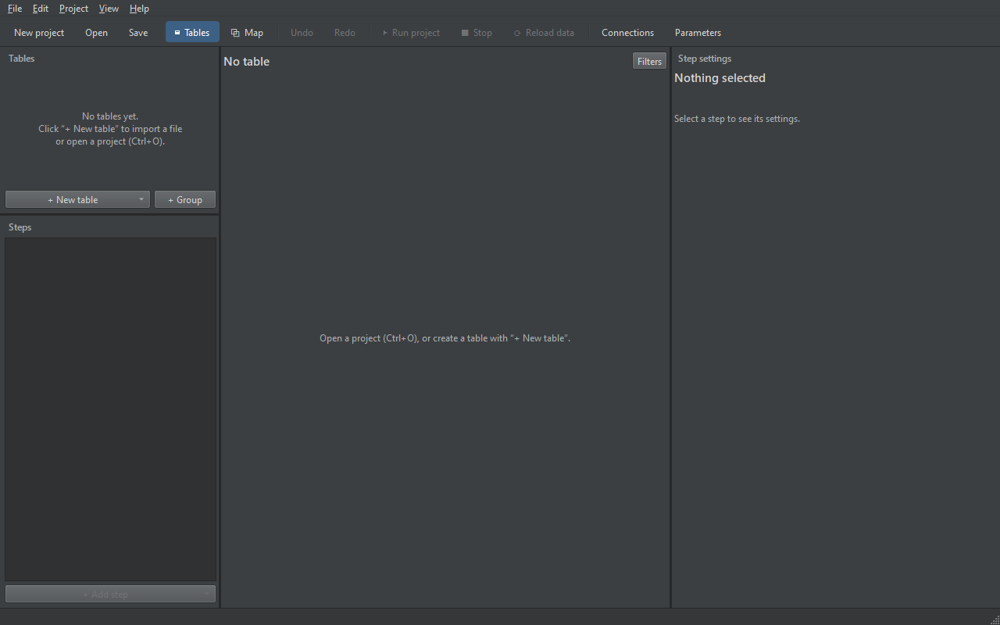

The window keeps its size and the layout of its panels for the next start.

### Open the demo

The demo is a small project with three tables: a customer list from Excel, orders from a CSV
file, and the revenue per customer.

1. Start `tafl-app.exe`.
2. Choose **File → Open** (Ctrl+O) and open `examples\demo.tafl` in the Tafl folder (in a
    source install: in the folder `examples` of the source code).

You can also drag `demo.tafl` onto `tafl-app.exe` in Explorer (not onto the open window).
A double-click on a `.tafl` file doesn't open it: `.tafl` files are not linked to Tafl.

The status bar says "Opened demo.tafl", and the first table, *Customers*, is selected. Now look
around:

- Click a table in **Tables** (top left). Its steps show below it in **Steps**, and the data
  panel in the middle shows the data after its last step.
- Click a step. The data panel shows the data after that step, and the settings panel on the
  right (**Step settings**) shows what the step does.

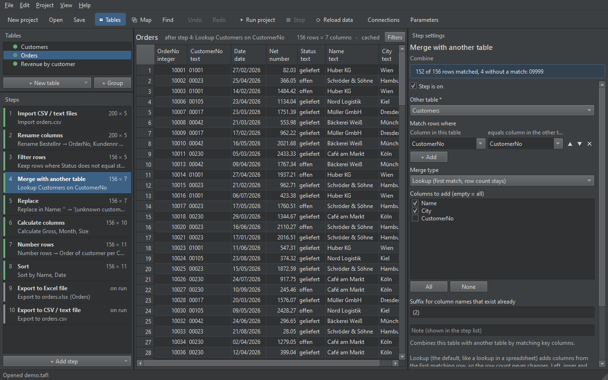

For example, click *Orders*, then step 4, *Merge with another table*. The columns Name and City
have just been added from *Customers*. Click step 3: they are not there yet.

Nothing is written while you look. The last steps of *Orders*, the exports, say "on run": they
run only when you run the project. Press **F5** (**Run project** in the toolbar): Tafl
calculates all tables and writes `orders.xlsx`, `orders.csv` and `revenue.xlsx` into
`examples\output`. [Chapter 3](#3-the-window) explains the window in detail.

### Help in the app

- **Help → User guide** opens this guide: `Guide.html` in the download, or this page on GitHub
  in a source install.
- **Help → Formula functions** (F1) lists every function you can use in formulas, with an
  example ([chapter 5](#5-formulas)).
- Many buttons and settings show a short explanation when you rest the mouse on them. The
  bottom of the settings panel explains the selected step.
- **Help → About Tafl** shows the version.

### Where Tafl keeps its settings

Tafl keeps three things outside its folder:

| What | Where |
|---|---|
| Window size, panel layout, recent projects | the registry key `HKEY_CURRENT_USER\Software\Tafl` |
| The log of the window (details of unexpected errors) | `%LOCALAPPDATA%\Tafl\tafl.log` (**Help → Open log folder**) |
| Your own plugins, if any ([chapter 12](#12-plugins)) | `%APPDATA%\Tafl\plugins` |

**Update to a new version**: close Tafl, delete (or rename) the old folder `Tafl`, and unzip
the new version in its place. Settings, log and plugins stay, as they are not in that folder.
Keep your own projects and data outside the folder `Tafl`, so that an update never touches them.

**Remove Tafl**: delete the folder `Tafl`. If you like, also delete the folders
`%LOCALAPPDATA%\Tafl` and `%APPDATA%\Tafl` (if they exist), and the registry key with regedit.

## 2. Your first project step by step

This chapter builds a small project from the start. Do the steps in Tafl as you read: each
section ends with what you should see.

### What you will build

The result is an Excel file with the revenue per customer, made from two files:

- `orders.csv`: 200 orders, as German accounting software exports them: semicolons between the
  values, decimal commas (`82,03`), dates as `27.02.2026`, and German column names: Bestellnr
  (order number), Kundennr (customer number), Datum (date), Netto (net amount) and Status. The
  status is `offen` (open), `geliefert` (delivered) or `storniert` (cancelled).
- `customers.xlsx`: the 6 customers, an Excel list with a title in its first row. The columns
  are Kundennr, Name and Ort (city).

Tafl reads both as they are. The first steps give the columns English names.

Prepare a folder for the project:

1. Make a folder, for example `C:\Reports\first`, with a subfolder `data`.
2. Copy `orders.csv` and `customers.xlsx` from `examples\data` in the Tafl folder into
    `C:\Reports\first\data`.

### Start a project

1. Choose **File → New project** (Ctrl+N). If another project is open, Tafl asks first, and
    offers to save it if it has changes.
2. Choose **File → Save as** (Ctrl+Shift+S), go to `C:\Reports\first` and save the project as
    `first.tafl`.

The title bar now says "first.tafl — Tafl".

Why save first: a file inside the project's folder is stored with a path relative to the
project file, here `data/orders.csv`. You can then move or copy the whole folder, and the
project still finds its files. (A file you choose before the first save is stored with its full
path; saving into the folder later makes it relative too.)

### Import the orders

1. Click **+ New table** below the Tables panel and choose **Import CSV / text files**.

    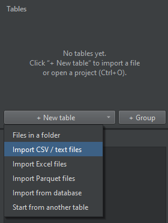

    A new table *Table 1* appears with one step, *Import CSV / text files*. Its dot is grey-blue
    and the settings say "Not complete yet: fill in File.": nothing is wrong, the step just needs
    its file.

2. In the settings panel, click **…** next to **File**. The file dialog opens in the project's
    folder. Choose `orders.csv` in the folder `data`.

The field shows `data/orders.csv`, and the table is renamed to *orders*, after its file. The
data panel shows the data: "200 rows × 5 columns".

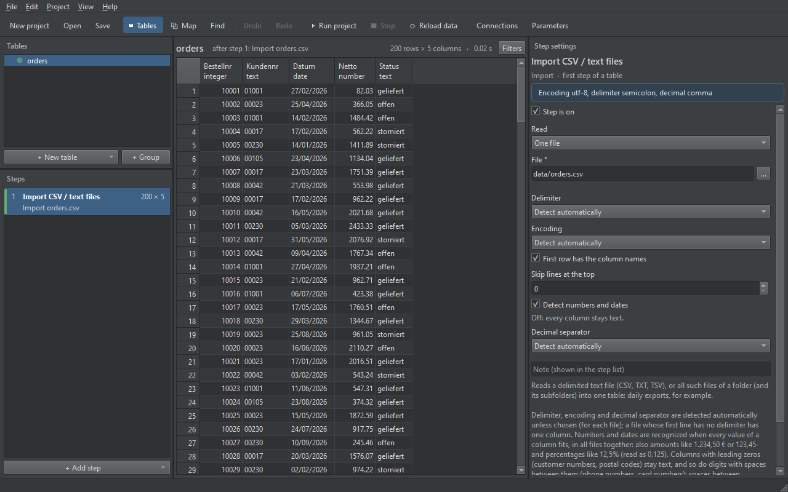

Under each column name is the type Tafl detected: Bestellnr *integer*, Kundennr *text*, Datum
*date*, Netto *number*, Status *text*. **Delimiter**, **Encoding** and **Decimal separator**
are set to **Detect automatically**: Tafl found the semicolons, the decimal commas and the
dates by itself, and the box at the top of the settings says so ("Encoding utf-8, delimiter
semicolon, decimal comma"). Kundennr stays text because of its leading zeros (`00017`): as a
number, they would be lost.

The grid shows dates in your Windows date format and decimals with your decimal separator. The
values themselves don't depend on it.

Tip: a text field applies what you typed when you press Enter or leave the field. Lists and
checkboxes apply at once.

### Rename the columns

1. Click **+ Add step** below the Steps panel and choose **Columns → Rename columns**.

    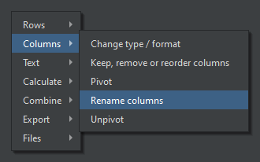

    A new step goes after the selected step. Here that is the import, so the new step becomes
    step 2.

2. The step starts with one empty row: **Column** and **New name**. In **Column**, choose
    `Bestellnr` from the list (or type it). In **New name**, type `OrderNo` and press Enter.
3. Click **+ Add** for the next row, and fill in the others the same way:

    | Column | New name |
    |---|---|
    | Bestellnr | `OrderNo` |
    | Kundennr | `CustomerNo` |
    | Datum | `Date` |
    | Netto | `Net` |

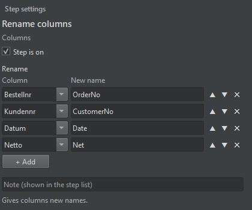

The step list shows step 2 as "Rename Bestellnr → OrderNo, Kundennr → CustomerNo, …", still with
200 × 5. The grid shows the new names.

Tip: while a row is empty, the step is *incomplete* (grey-blue, "incomplete" in the step list).
Fill the row in, or remove it with **✕** at its end.

### Filter the rows

Cancelled orders don't count as revenue.

1. Click **+ Add step** and choose **Rows → Filter rows**.
2. In the first condition, choose **Column** `Status`, the operator **does not equal**, and type
    `storniert` as **Value** (Enter).
3. Leave **Rows must match** at **all conditions (AND)** and **Then** at **Keep matching rows**.

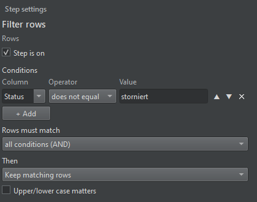

156 rows are left. The step list shows the size after each step on the right, so you see at a
glance where rows disappear: 200 × 5 after step 2, 156 × 5 after step 3.

The other operators, and how to write numbers and dates in a condition, are in
[chapter 4](#rows-filter-sort-fill-and-check).

### Calculate a column

Add the gross amount, the net amount with 19 % VAT.

1. Click **+ Add step** and choose **Calculate → Calculate columns**.
2. Type `Gross` into **Column name**.
3. Click into the formula field below it and type `ROUND(`, then `[`: a list of the columns
    opens. Choose `Net` from it (or keep typing). Type the rest, so that the field says
    `ROUND([Net] * 1.19, 2)`, and press Enter. Column names are written in square brackets.

![Calculate columns: Gross = ROUND([Net] * 1.19, 2), with the first results under the formula](guide/first-calculate.png)

While you type, the line under the formula shows what it gives, for example "→ number: 97.62,
435.6, 1766.46, … · no errors in all 156 rows". If something is wrong, it says what instead.
The table now has 6 columns: Gross is the last one. [Chapter 5](#5-formulas) has all about
formulas.

### Add up per customer

1. Click **+ Add step** and choose **Calculate → Aggregate**.
2. Under **Group by (empty = one total row)**, tick `CustomerNo`.
3. Under **Calculate**, the first row is already there: leave **Sum**, choose the column
    `Gross`, and type `Revenue` as the result name.
4. Click **+ Add**. Choose **Count rows** in the new row (it needs no column) and type `Orders`
    as the result name.

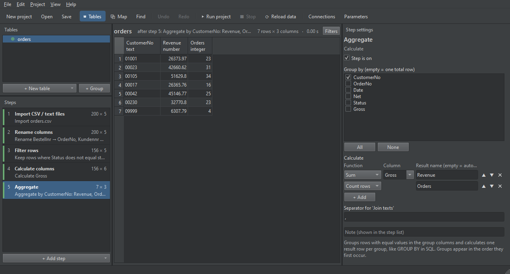

The result has 7 rows × 3 columns: CustomerNo, Revenue and Orders, one row per customer. Six of
them are in the customer list; 09999 is not (it will matter in the next section). Without a
result name, Tafl names the column itself.

### Bring in the customer names

The names and cities are in `customers.xlsx`. They come in through a second table.

**The customer table:**

1. Click **+ New table** and choose **Import Excel files**.
2. Click **…** next to **File** and choose `customers.xlsx` in the folder `data`. The table is
    named *customers*.

The grid looks wrong at first: the column names are "Kundenliste (Stand 01.10.2026)",
"Column 2" and "Column 3", and the real column names are in the first row. The sheet has a
title in row 1 and an empty row 2; the column names are in row 3.

3. Set **Row with the column names** to `3`. Now the table has 6 rows × 3 columns: Kundennr,
    Name, Ort. **Sheet** stays empty: that means the first sheet.

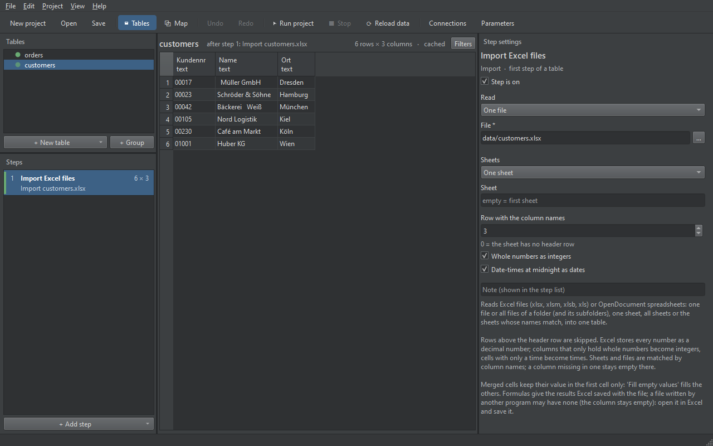

4. Add **Columns → Rename columns**: Kundennr → `CustomerNo`, Ort → `City`.
5. Add **Text → Clean text**. Under **Columns (empty = all text columns)**, tick `Name`, and
    tick **Replace repeated spaces with one**.

Some names in the list have spaces at the start and end, or several spaces in a row inside.
**Remove spaces** (at start and end, the default) and **Replace repeated spaces with one** tidy
them up: they become "Müller GmbH" and "Bäckerei Weiß".

**The lookup:**

6. Click *orders* in the Tables panel. Its last step, *Aggregate*, is selected, so the next step
    goes after it.
7. Click **+ Add step** and choose **Combine → Merge with another table**.
8. Choose **Other table** `customers`.
9. Under **Match rows where**, choose `CustomerNo` in **Column in this table** and `CustomerNo`
    in **equals column in the other table**.
10. Leave **Merge type** at **Lookup (first match, row count stays)**.
11. Under **Columns to add (empty = all)**, tick `Name` and `City`.

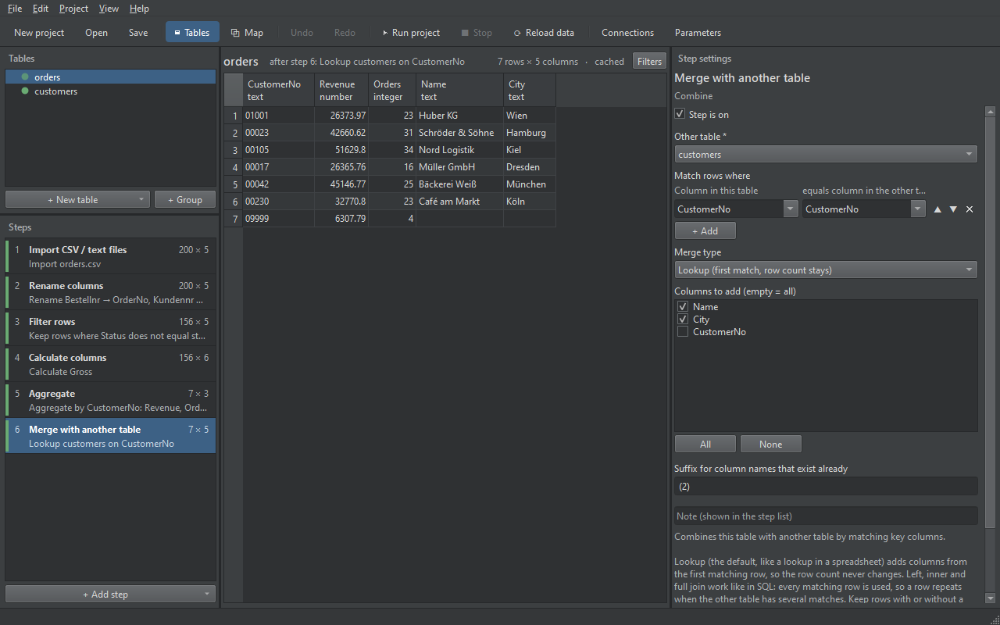

The table has 7 rows × 5 columns now, with Name and City. Customer 09999 is not in the list, so
its Name and City stay empty. The box at the top of the settings says so: "6 of 7 rows matched, 1
without a match: 09999". A lookup never changes the number of rows: it only adds columns.
The other merge types (joins, keep rows with or without a match) are in
[chapter 4](#combine-merge-and-append-tables).

### Sort the result

1. Click **+ Add step** and choose **Rows → Sort**.
2. Choose **Column** `Revenue` and **Order** **Descending (Z→A, 9→1)**.

The customer with the most revenue is now at the top. The step list shows "Sort by Revenue ↓".

### Export to Excel

1. Click **+ Add step** and choose **Export → Export to Excel file**.
2. Type `output/revenue.xlsx` into **File** (Enter). The folder `output` is created by the
    export when it doesn't exist.
3. Type `Revenue` into **Sheet name** (instead of `Sheet1`).
4. Under **Formats for single columns**, click **+ Add**, choose the column `Revenue` and type
    `#,##0.00 €` as **Excel format**.

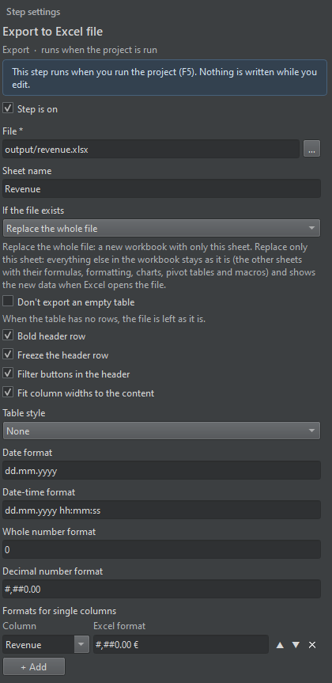

The box at the top of the settings says "This step runs when you run the project (F5). Nothing
is written while you edit." The step list shows "on run" for it. An export never writes while
you build or look at a project: only a run does.

The other settings can stay as they are: a bold header row with filter buttons, column widths
that fit the content, dates as `dd.mm.yyyy`. [Chapter 9](#export-a-formatted-excel-file) explains
them.

### Name the table

The table is still called *orders*, after its file. Double-click it in the Tables panel (or
select it and press F2), type `Revenue by customer` and press Enter.

### Run and save

1. Press **F5** (**Run project** in the toolbar).

The **Run results** open at the bottom of the window. The first line says "Run finished at …: 2
tables, no errors" and how long the run took. Below it are the tables with their steps, each
with its rows × columns and its time. Click the arrow in front of the export step to see the
file it wrote: "Wrote 7 rows to C:\Reports\first\output\revenue.xlsx (sheet 'Revenue')".

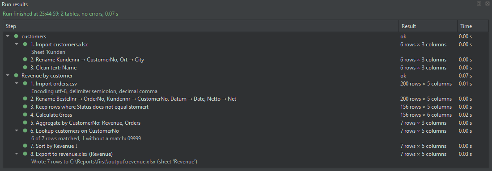

2. Open `C:\Reports\first\output\revenue.xlsx` in Excel: one sheet *Revenue* with the 7
    customers, the revenue formatted in euros.
3. Close the workbook in Excel, then save the project in Tafl: **File → Save** (Ctrl+S).

The project is the recipe, not the result: the next run reads the files again and writes a new
`revenue.xlsx`. Try it: in *Revenue by customer*, click step 3, *Filter rows*, change **Then** to
**Remove matching rows** (now only the cancelled orders are left), and press F5. The export
replaces the file. Then change it back (or press Ctrl+Z) and run again.

Tip: close the file in Excel before you run. An export can't replace a file that is open in
Excel: the run reports that the file is open in another program, and the old file stays as it
was.

### What next

- See the project as a map of its tables: press Ctrl+2 ([chapter 6](#6-the-project-map-and-groups)).
- Run it every morning without opening Tafl ([chapter 11](#11-running-projects-on-a-schedule)).
- Look up the other actions in [chapter 4](#4-actions).

## 3. The window

### The parts of the window

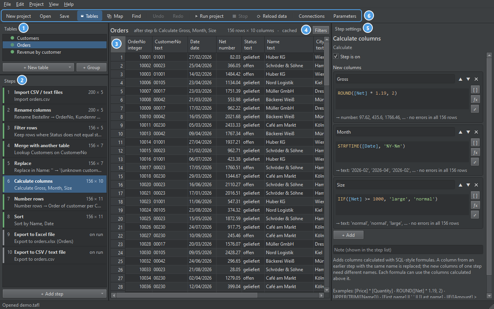

1. **Tables**: the tables of the project.
2. **Steps**: the steps of the selected table.
3. The data panel: the data after the selected step. Its title line shows the table, the step
    ("after step 6: Calculate Gross, Month, Size"), the size ("156 rows × 10 columns") and how
    long the step took ("0.13 s"), or "cached" when the result was already there.
4. **Filters**: opens the filter pane beside the grid.
5. **Step settings**, the settings panel: the settings of the selected step, with its help text
    at the bottom.
6. The toolbar: **New project**, **Open**, **Save**, **Tables** and **Map** (the two views),
    **Find** ([the Find panel](#the-find-panel)), **Undo**, **Redo**, **Run project**, **Stop**,
    **Reload data**, **Connections** and **Parameters**.

The menus are **File**, **Edit**, **Project**, **View** and **Help**. The status bar at the
bottom shows short messages, such as "Opened demo.tafl" or "Run finished — see Run results".
Drag the borders between the panels to change their sizes. Tafl keeps the layout.

### The Tables panel

Click a table to see the data after its last step.

- **+ New table** starts a table. Its menu lists the imports, and **Start from another table**
  to continue from the result of another table.
- **+ Group** makes a group. In the Tables panel, groups are folders: drag tables into them.
  Groups are most useful on the map ([chapter 6](#6-the-project-map-and-groups)).
- Double-click a table (or press F2) to rename it. Drag a table to move it.
- Del deletes the selected table. Tafl asks first, and names the tables that use it.
  **Edit → Undo** brings it back.

Right-click a table for **New table**, **New group…**, **Rename**, **Duplicate**, **Run this
table**, **Turn table off**, **Move to group** and **Delete**.

A table that is turned off is shown in grey italics. It is not calculated, and its exports
don't run. A table that uses it can't be calculated either: it shows as *skipped*, "it uses
“Orders”, which is turned off". That is no error. Turning a table off is handy while you work
on a big project, or to keep a table you don't need right now.

Tables are calculated when you look at them: when a project opens, its first table and the
tables it uses; then each table you click. A table that wasn't calculated yet has a blue dot
and the tooltip "Not calculated yet". On the map, all tables are calculated.

### The Steps panel

Click a step to see the data after it. Each step shows its number, its action, a summary of
its settings, and on the right the size of the data after it ("156 × 10") or a word such as
"on run".

- **+ Add step** adds a step after the selected step.
- Drag a step, or press Ctrl+↑ or Ctrl+↓, to move it.
- Del deletes the selected step, without asking. Ctrl+Z brings it back.

Right-click a step for **Add step after this**, **Turn off**, **Duplicate**, **Move up**, **Move
down** and **Delete**.

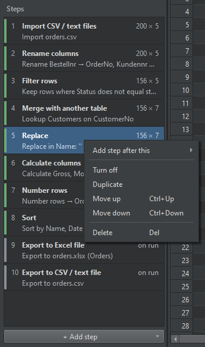

A step that is turned off is dimmed and says "off": the data passes it unchanged. Turn a step
off to see what the table looks like without it, instead of deleting it. **Step is on** at the
top of the step's settings does the same.

**Note (shown in the step list)**, under the settings, is a comment of yours. The step list
shows it after the summary, for example "Keep rows where Status does not equal storniert —
cancelled orders don't count".

### Status colors

The stripe at the left of a step and the dot in front of a table show its status:

| Color | Step | Table |
|---|---|---|
| Green | ok, with the size of its data | all steps ok |
| Red | error: the step says what is wrong | a step has an error, or it uses a table with an error |
| Orange | ok, with a warning (shown in its settings) | |
| Grey-blue | *incomplete*: a setting is missing | *incomplete* or *waiting* |
| Grey | off, or an export or command that runs only in a run ("on run") | turned off, or *skipped* |
| Dim brown | not calculated, because a step above it has an error or is incomplete | |
| Blue | not calculated yet | not calculated yet |

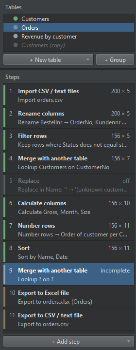

**Incomplete** is no error. A new step is incomplete until its required settings are filled
in. Its summary shows a `?` for what is missing ("Lookup ? on ?"). The grid shows the data
*going into* the step, so you can see the columns you choose from, and the settings say what to
fill in: "Not complete yet: fill in Other table, …". The steps after it are calculated once it
is complete.

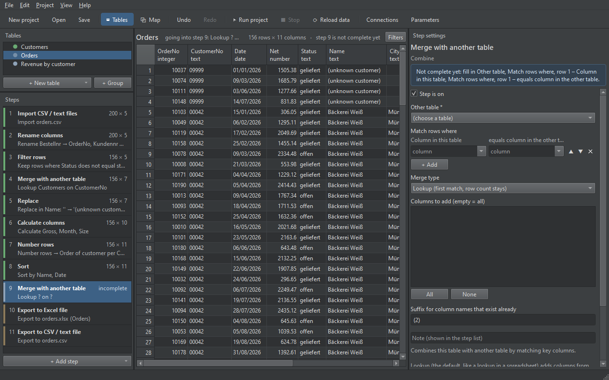

**Waiting**: a table that uses a table with an incomplete step waits for it. Its first step
says "waiting", and the grid says which table and step it waits for, for example "Step 1 waits
for “Orders”, whose step 9 is not complete yet".

**Error**: click the red step to see the message. The steps after it are not calculated, and the
tables that use this table get an error too ([Where errors show](#where-errors-show)).

A run is stricter than the window: it counts an incomplete step as an error, as it can't write
a correct result.

### The settings panel

The settings panel shows the selected step's action, its category, and for imports and exports
a short note ("first step of a table", "runs when the project is run").

- Text fields apply when you press Enter or leave the field. Lists, choices and checkboxes apply
  at once.
- SQL fields apply with Ctrl+Enter or when you leave them, as Enter starts a new line there.
- Formula fields apply with Enter; Shift+Enter starts a new line.
- A `*` after a name marks a setting the step needs.
- **…** next to a file or folder opens a file dialog. You can also type the path.
- Lists of settings (renames, conditions, formulas) have **+ Add** for a new row, and **▲**,
  **▼** and **✕** at the end of each row to move or remove it.

The box at the top of the settings shows what the step reported when it was calculated: what an
import detected ("Encoding utf-8, delimiter semicolon, decimal comma"), how many rows a merge
matched ([chapter 4](#combine-merge-and-append-tables)), or for an export or a command that it
runs only when you run the project. Warnings and errors have boxes of their own, orange and red.

After a change, the table is calculated again in the background: "Calculating…" shows in the
title line of the data. You can go on working meanwhile.

**Run project** (F5) and **Save** (Ctrl+S) apply what you have typed in a field first, so
nothing typed gets lost.

### The data panel

The grid of the data panel shows the data after the selected step. Under each column name is its
type: *text*, *integer*, *number*, *date*, *date-time*, *time* or *true/false*. **Change type /
format** ([chapter 4](#columns-names-order-types-pivot-and-unpivot)) calls them *Text*, *Whole
number* (integer), *Decimal number* (number), *Date*, *Date and time* (date-time) and *True /
false*.
Dates appear in your Windows date format and decimals with your decimal separator. An empty cell
stays empty (its tooltip says "(empty)").

- Select cells and press Ctrl+C to copy them, for pasting into Excel (at most 2,000,000 cells;
  for more, export the table). Ctrl+A selects all cells.
- Right-click a cell for **Show only rows where City is “Hamburg”** and **Filter by City** (with
  the cell's column and value), or a column header for **Filter by …**. Both open the filter
  pane.

### The filter pane

The filter pane shows only some of the rows, without adding a step. It changes only what you
see: never the data of a step, a run or an export. It stays while you click through the steps,
so you can follow a few rows through a table.

1. Click **Filters** above the grid. The pane opens at its left.
2. Click **+ Filter** and choose a column (or right-click a cell or a column header).
3. The card of the column lists its values, with how many rows have each. Click a value, or
    select several with Ctrl+click and Shift+click.
4. Click **Apply** (or press Enter). A double-click on a value filters by that value alone.

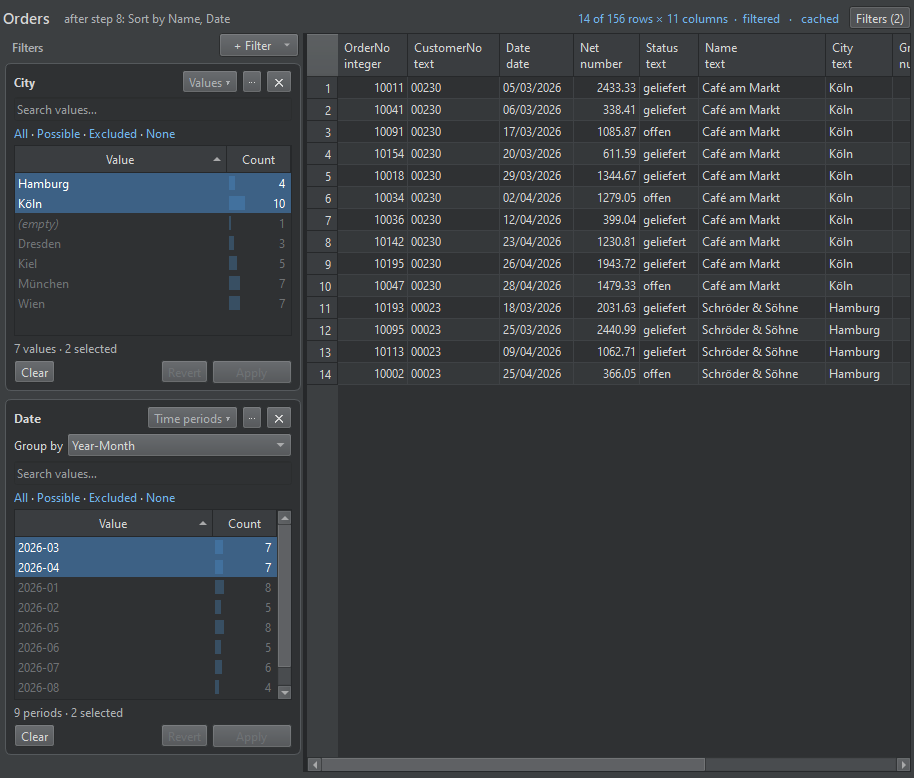

The title line of the data then says, for example, "14 of 156 rows × 11 columns · filtered" (in
blue), and the button says **Filters (2)**.

- **Revert** goes back to the values that are applied. **Clear** stops filtering by the column.
  **✕** removes the card.
- **All** · **Possible** · **Excluded** · **None** select values quickly. **Possible** are the
  values that the other filters leave; **Excluded** inverts a selection.
- Colors: the selected values are blue, the possible ones white, the others grey. The counts are
  the rows that pass the *other* filters.
- The button next to the column name switches the mode: **Values**, **Time periods** (dates by
  Year, Year-Quarter, Year-Month, Year-Week (ISO) or Date), **Number ranges** (thresholds such as
  `500; 1000`), **Text length** and **Pattern (regex)**.
- Several values of one card: rows with any of them. Several cards: rows that pass all of them.
- At a step that doesn't have the column, the card says "Not used at this step".
- **⋯ → Add as step (Filter rows by formula)** turns a card into a real step after the selected
  step, and removes the card. As a step, the filter applies in runs and exports too.

Each table has its own filters. They are saved with the project, but they are no edits: undo
doesn't change them.

### The Find panel

The Find panel finds steps anywhere in the project, and lists everything the project reads and
writes outside of it. It stays open beside the tables view and the map.

Click **Find** in the toolbar, choose **Edit → Find in project…** or press Ctrl+Shift+F: the panel
opens at the left, with the cursor in its search field. **View → Find panel** shows or hides it.
Drag its title to put it at the right or at the bottom; Tafl keeps where it is.

**Imports, exports and commands.** With an empty search field, the panel lists every step that
reads, writes or changes something outside the project, in the groups **Imports**, **Exports** and
**Commands** (file commands and SQL commands). Each result has two lines:

- its kind (**in**, **out** or **cmd**), the table, the step number and the action, for example
  "Daily orders · 5 · Export to Excel file";
- what it reads or writes: a file, folder or sheet ("daily orders.xlsx, sheet Orders in output"),
  or a connection and its database table or SQL ("revenue on Shop").

Paths are shown as the settings have them, relative to the project's folder; the tooltip has the
full path. A path with a parameter is shown as written and with the value now, as in the example
of [chapter 7](#7-parameters): "orders {Month}.xlsx, sheet {Month} in output now: orders
2026-03.xlsx, sheet 2026-03". The line above the results counts them: "2 imports · 2 exports · 2
commands". Before you run a project from someone else, this is the list to look at.

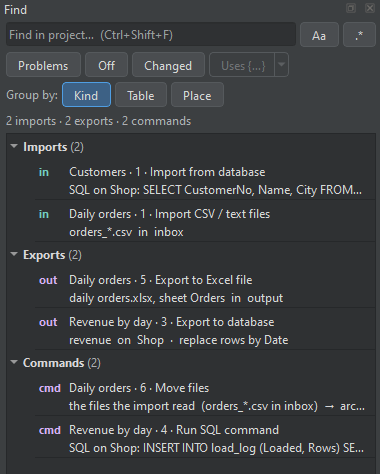

**Search.** Type into the field: the panel finds the steps whose texts contain all the words, in
any order, without regard to upper and lower case. It searches the names of the table, its group
and the action, the step's summary and note, and every setting you type: files, folders, sheets,
SQL, formulas, conditions and column names, also the connections (with their server and
database) and the parameters. A setting with a parameter is found by the parameter's name and by
its value now. What the list says about how a file is read or written is found too, for example
"to the Recycle Bin" or "first sheet". **Aa** makes upper and lower case count; **.\*** takes the
text as a regular expression, written as for the filter pane's **Pattern (regex)**: look-ahead,
look-behind and back-references don't exist there, and a brace is written `\{`, so a search for
the parameter {Month} as a pattern is `\{Month\}`. The panel says when a pattern is not valid.

The second line of a result shows the setting that matched, with the match marked, for example
"Match rows where, row 1 – Column in this table: CustomerNo", or "Group: Sources" when only the
name of the table's group matched. The line above the results says "4 steps in 2 tables", or
"Nothing found". A result of a step that has a problem or is turned off says so at the right:
*error*, *warning*, *incomplete*, *waiting* or *off*. Problems show once the step's table has been
calculated: on the map all tables are, in the table view the selected table and the tables it
uses (the **Problems** filter calculates the others).

**Go to a result.** Click it: Tafl selects its table and step, in the table view or on the map
(the box comes into view, and a collapsed group opens; that is a change of the map, as if you
had opened it, and Ctrl+Z closes it again). The panel stays open, so you can click through the
results. Enter or a double-click also puts the cursor into the setting that matched, and marks it
for a moment; for a step that is not complete yet, into the setting to fill in. F3 and Shift+F3
go to the next and the previous result from anywhere in the window, also while you type in a
setting or a note: what you typed is applied to its step first (Ctrl+Z takes it back and shows
that step again), and the keyboard stays in the step settings instead of moving into a setting
of the next step. When the current result leaves the list, for example because you fixed its
problem, F3 goes on with the result after its place (such as the next error of the same table)
and Shift+F3 with the one before, also after you change **Group by**.

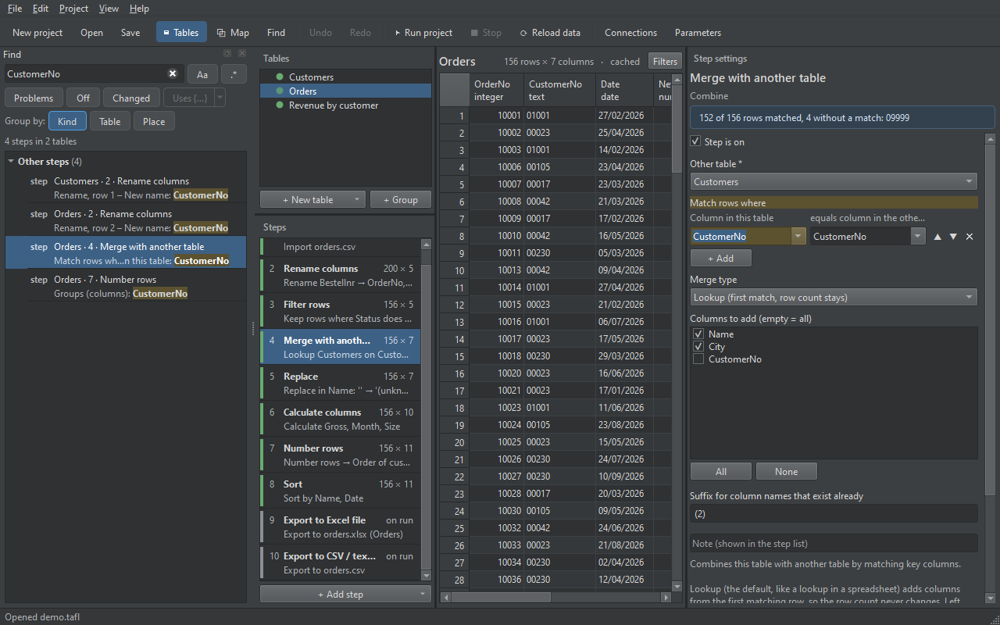

**Filters**, the buttons below the field, show only some of the steps, with or without a search:

- **Problems**: steps with an error or a warning, steps that are not complete yet, and the steps
  waiting for them. Tafl first calculates the tables that were not calculated yet; meanwhile the
  line above the results says "calculating all tables…". If you select another table or change a
  step meanwhile, Tafl calculates that table first and then goes on with the others.
- **Off**: steps and tables that are turned off.
- **Changed**: steps changed since the project was opened, also new ones. A step whose settings
  are back as they were is not listed.
- **Uses {…}**: steps that use a parameter. The arrow next to it chooses one parameter, for
  example **{Month}**. When you rename that parameter, the filter follows the new name.

**Group by** sorts the results into groups:

- **Kind** (the default): Imports, Exports, Commands and Other steps.
- **Table**: the map group, the table, then its steps.
- **Place**: the folder or connection, the file or database table, then the steps that read or
  write it. This answers "which steps write into this file?". A folder written in two ways is one
  place, for example `output` and `C:\Reports\output` in a project saved in `C:\Reports`. A file
  command that takes the files the import read is listed under the import's folder and files,
  with the parameters' values now, as the import is, when the table's first step imports all
  files of a folder (CSV, Excel or Parquet); otherwise, e.g. after *Files in a folder*, it is
  under **Files the import read**. A database export or SQL command without a connection yet is
  under **No connection chosen**.

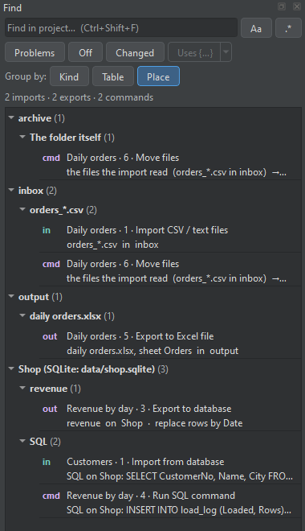

Keys: in the search field, Enter goes to the next result (Shift+Enter to the one before), ↓ moves
into the results, and Esc clears the field (in an empty field, Esc goes back to the view). In the
results, ↑ and ↓ go to the result before or after, as a click does, and Esc goes back to the
search field.

### Running a project

- **Run project** (F5) calculates all tables and executes their exports and commands.
- **Run this table** (Shift+F5, in the **Project** menu or a table's right-click menu) does the
  same for the selected table and the tables it uses. Their exports run too.
- **Stop** stops a running formula at once. Another step that is running finishes first: an
  export can take a while. The Run results then list what ran before the stop (exports included)
  and the steps that did not run.
- **Reload data** (Ctrl+R) reads all files and databases again and updates the status of every
  table.

A file that has changed is also read again by itself when its table is calculated again: when
you select the table again (after another table), change one of its steps, or run. Clicking a
step, or the table that is already selected, only shows what was calculated.

**Run results** open after every run (and with **View → Run results**). They list every table
and its steps, with the result, the time and the messages, such as the file an export wrote. A
step with a warning is orange and open, so that the warning shows, and the first line counts the
warnings ("…, no errors, 1 warning"). Double-click a line to go to that table and step; the
arrow in front of a line opens and closes it. [Run and save](#run-and-save) in chapter 2 has a picture.

If you close the window during a run, Tafl asks: **Wait, then close**, or **Stop the run**
(after the step that is running), or **Cancel**.

### Undo and redo

**Edit → Undo** (Ctrl+Z) and **Redo** (Ctrl+Y) work for every change to the project: steps,
settings, tables, groups, positions on the map, connections and parameters, up to 100 changes
back. The filters in the filter pane are not part of it.

Undo and Redo in the toolbar or the Edit menu first apply what you are typing in a setting or a
note, as saving and running do, so Undo takes back just that typing. Redo while you type has
nothing to redo: what you typed is a new change, and the status bar says so. Inside a text
field, Ctrl+Z and Ctrl+Y undo and redo the typing in the field.

### Saving and opening projects

- **File → Save** (Ctrl+S) saves the project. A `•` in the title bar ("first.tafl •") means
  there are unsaved changes.
- Before another project replaces the open one, or the window closes, Tafl asks whether to save:
  **Save**, **Don't save** or **Cancel**.
- **File → Save as** (Ctrl+Shift+S) into another folder keeps every file path pointing at the
  same files. Files in the new folder (or below it) are stored relative to the project, others
  with their full path. So a copy saved elsewhere still reads and writes the same files as the
  original.
- **File → Open recent** lists the last projects.
- If the project file was changed since you opened it, for example in a second Tafl window,
  saving asks before it replaces those changes (**Save anyway** or **Cancel**; use **Save as**
  to keep both).
- A project from an older version of Tafl opens as usual. If some of its steps were saved by
  older versions of their actions, the status bar says so, for example "1 step(s) were updated to
  newer action versions; save to keep this".

A `.tafl` file is a text file (JSON): you can open it in a text editor to see what it does.

### Projects from other people

Tafl calculates a table as soon as you look at it, with your Windows rights. When you open a
project, its imports read the files and databases the project names, and the SQL queries of
database imports run on those databases. Exports and commands run only when you run the
project.

Tafl rolls back what an import's query changes, and formulas can only use the data of their
step. Still, a project can read whatever your Windows login can read. Open projects only from
people you trust. If in doubt, open the `.tafl` file in a text editor first: its connections,
SQL queries and file paths can be read there. Before you run a project from someone else, look
at its exports and commands, above all **Delete files** and **Run SQL command**. The
[Find panel](#the-find-panel) lists them all when its search field is empty, with every file,
folder and database the project reads or writes.

## 4. Actions

Every step of a table is an action: an import, a change to the rows or columns, an export or a
command. This chapter is a reference of all actions, grouped as in the menus.
[Chapter 2](#2-your-first-project-step-by-step) shows many of them at work, with pictures of both
menus.

**+ New table** in the Tables panel lists the imports: every table starts with one (in a table
without steps, **+ Add step** lists them too). **+ Add step** lists all other actions in the
submenus **Rows**, **Columns**, **Text**, **Calculate**, **Combine**, **Export** and **Files**.
The new step goes after the selected step. Right-click a step for the same menu under **Add step
after this**.

What works the same in every action:

- Point at an action in a menu to see what it does. The same text is at the bottom of the
  settings panel.
- A setting whose name ends with `*` is required. Until it is filled in, the step is *incomplete*,
  and the settings say what is missing, for example "Not complete yet: fill in Columns." [The
  settings panel](#the-settings-panel) explains how settings are filled in.
- Where you choose several columns, tick them in the list and drag them into the order you want;
  **All** and **None** tick or untick all of them.
- Exports and commands (menus **Export** and **Files**) run only when you run the project (F5)
  or a table (Shift+F5). While you edit, the step list shows *on run* for them. The table passes
  through them unchanged.

### Imports: the first step of a table

**Files in a folder** makes a table of the files in a **Folder** `*`, one row per file.
**File names** is a pattern (`*` stands for any text, several patterns with `;`, e.g.
`*.csv;*.txt`); **Include subfolders (all levels)** looks into the subfolders too. The columns:
**File**, **Path** (below the folder, e.g. `2026\02\orders.csv`), **Folder** (the subfolder),
**Extension**, **Size** (in bytes), **Modified** and **Full path**. Use it to check what arrived in
a folder, or to choose the files for a file command: filter the table, then **Copy files** with
**Column with the files**: *Full path* copies exactly the files that are left.

**Import CSV / text files** reads a delimited text file, or all such files of a folder into one
table.

- **Read**: *One file* or *All files in a folder* (see [All files of a folder](#all-files-of-a-folder)
  and [chapter 10](#10-days-without-data-and-a-daily-inbox)).
- **Delimiter**, **Encoding** and **Decimal separator**: *Detect automatically*, or the one the
  file uses.
- **First row has the column names** (on); off, the columns are *Column 1*, *Column 2*, …
- **Skip lines at the top**: for a title line above the column names.
- **Detect numbers and dates** (on): a column becomes an integer, number, date or date-time
  column when every value fits. Off: every column stays text.

Values with leading zeros, such as customer numbers (`00017`) and postal codes, stay text
([Import the orders](#import-the-orders) shows an example). Amounts like `1.234,50 €` and
percentages like `12,5%` (0.125) become numbers. The box at the top of the step's settings says
what was detected, and so do Run results under the step: "Encoding utf-8, delimiter semicolon,
decimal comma".

Tip: if the columns look wrong, for example with a warning that rows have more values than the first
row, the first line is probably a title, not the column names. Set **Skip lines at the top** to
`1`.

**Import Excel files** reads a sheet of an Excel workbook (xlsx, xlsm, xlsb, xls) or an
OpenDocument spreadsheet (ods), or the workbooks of a folder.

- **Read**: as for CSV. For a folder, add `;*.ods` to **File names** to read ods files too.
- **Sheets**: *One sheet* (**Sheet**: empty = the first sheet), *All sheets*, or *Sheets whose name
  matches* (**Sheet names**, e.g. `2025*` or `Jan;Feb`). With several sheets, a column **Sheet**
  names the sheet of each row.
- **Row with the column names** (`1`): the rows above it are skipped; `0` = no header row.
- **Whole numbers as integers** and **Date-times at midnight as dates** (both on): Excel stores
  every number as a decimal number and every date as a date-time. These turn columns with only
  whole numbers into integer columns, and columns whose times are all 00:00 into date columns.

Example: `customers.xlsx` has a title in row 1 and the column names in row 3: see
[Bring in the customer names](#bring-in-the-customer-names).

Tips: a first column named like a title next to *Column 2*, *Column 3* means the column names
are further down. Empty rows are left out. Merged cells keep their value in the first cell only:
**Fill empty values** fills the others. Formulas give the results Excel saved; a workbook written
by another program may have none: open it in Excel and save it.

**Import Parquet files** reads a Parquet file, or all Parquet files of a folder. Parquet files
store the type of every column, so nothing has to be detected. (Tafl reads Parquet files, but
doesn't write them.)

**Import from database** reads a table, a view or the result of a SQL query from a SQL Server or
SQLite connection: see [Read a table or a query](#read-a-table-or-a-query) in chapter 8.

**Start from another table** starts this table with the result of another **Table** `*`. Use it
to branch off: the demo's *Revenue by customer* starts from *Orders* and adds up its orders per
customer, while *Orders* is exported as it is. Changes to *Orders* flow through.

### Rows: filter, sort, fill and check

**Fill empty values** fills the empty cells of the chosen **Columns** `*`. **Fill with**: *the
value above (fill down)*, *the value below (fill up)* or *a fixed value* (**Value**). Example: an
Excel list that names each region only at its first store:

| Region | Store | Sales |
|---|---|---|
| North | Kiel | 100 |
| | Lübeck | 80 |
| South | Ulm | 120 |
| | Passau | 95 |

Fill down on Region writes North next to Lübeck and South next to Passau, so you can filter and
add up by region. A fixed value must fit the column: `none` in a number column stops the step
with "'none' is not a number (column 'Net')".

**Filter rows** keeps or removes the rows that match conditions.

- **Conditions**: rows of **Column**, **Operator** and **Value**. Operators: *equals*, *does not
  equal*, *is greater than* (*or equal to*), *is less than* (*or equal to*), *contains*, *does not
  contain*, *starts with*, *ends with*, *is one of (separate with ;)*, *is none of (separate with
  ;)*, *is empty*, *is not empty*.
- **Rows must match**: *all conditions (AND)* or *any condition (OR)*.
- **Then**: *Keep matching rows* or *Remove matching rows*.
- **Upper/lower case matters** (off).

Values are compared with the column's type: `1.000,00` and `1000` are numbers in a number column;
`31.12.2025`, `2025-12-31` and `today` are dates in a date column. With the 200 demo orders:
Status *does not equal* `storniert` keeps 156 rows, Net *is greater than* `1.000,00` keeps 116,
Date *is greater than or equal to* `01.09.2026` keeps 20.

Tip: empty cells never equal a value, but they count for *does not equal* and *does not
contain*. To find empty cells, use *is empty*.

**Filter rows by formula** keeps (or, with **Then**, removes) the rows for which a **Condition**
`*` is true, for example `[Net] >= 1000 AND [City] IN ('Hamburg', 'Köln')`. Use it for what **Filter
rows** can't say: comparing two columns, calculations, AND and OR together. A row where the
condition is empty counts as false. Formulas: [chapter 5](#5-formulas).

**Remove duplicates** removes rows that are equal in **Compare these columns (empty = all)**.
**Of rows that are equal, keep**: *the first*, *the last* or *none (remove all of them)*. The row
order stays. Example: compared by CustomerNo, the 200 orders become 7 rows, the first order of
each customer. For the latest order instead, **Sort** by Date *Descending* first.

**Skip the rest if a table is empty** ends the table at this step when **Which table** (*This
table (the data at this step)* or *Another table*) has no rows. The steps after it are skipped;
that is not an error. Put it before the exports, so a day without data writes nothing
([chapter 10](#10-days-without-data-and-a-daily-inbox)).

**Sort** sorts the rows by the columns in **Sort by**, each *Ascending (A→Z, 1→9)* or
*Descending (Z→A, 9→1)*. **Empty values last** (on) puts empty cells at the end. Text sorts as in
Excel: upper and lower case count the same, ä sorts with a, ß like ss. Rows with equal values
keep their order, so the demo's sort by Name, then Date (step 8) lists each customer's orders by
date.

Tip: numbers in a text column sort as text, so `12345` comes before `5000`. Change the column to a
number first (**Change type / format**).

**Check data** checks the table at this step, and stops the table or only warns when a check
fails. The data itself passes the step unchanged.

- **Checks**: one row per check. **Check**: *Number of rows*; **Must be**: *at least*, *at
  most*, *exactly* or *between*; **Number**, and for *between* the second number in **and**.
  *at least* `1` means that the table must not be empty. **+ Add** adds a check; the step checks
  all of them.
- **When a check fails**: *Stop the table* (the default) or *Only warn*.

A new step starts with one check, at least 1 row, and *Stop the table*. The step list then shows
"Check: at least 1 row, else stop".

- *Stop the table*: the step has an error, like a step that fails, and says what is wrong, for
  example "The table has no rows; it must have at least 100 rows". The steps after it are not
  calculated, so the table's exports and commands don't run, and the tables that use this table
  get the error too. A run fails: Run results show the message, and the command line ends with
  exit code 1 ([chapter 11](#exit-codes)).
- *Only warn*: the step shows the same text as a warning (orange), and so do Run results (the
  step is open there, and the first line counts the warnings) and the command line (with `!`).
  The data goes on, and a warning alone doesn't make a run fail.

When every check passes, the box at the top of the settings says so: "The check passed: the
table has 200 rows", or with two checks "All 2 checks passed: …". When several checks fail, the
message names each of them: "The table has 37 rows; it must have at least 100 rows and between
50 and 500 rows". What the step says:

| At this step, the table has | Check | Message |
|---|---|---|
| 200 rows | at least 100 rows | The check passed: the table has 200 rows |
| no rows | at least 100 rows | The table has no rows; it must have at least 100 rows |
| 37 rows | at least 100 rows | The table has 37 rows; it must have at least 100 rows |
| 25,000 rows | at most 10,000 rows | The table has 25,000 rows; it must have at most 10,000 rows |
| 7 rows | between 10 and 100 rows | The table has 7 rows; it must have between 10 and 100 rows |

An example: in the demo, *Orders* reads `orders.csv`, which has 200 orders. A **Check data** step
right after the import, as step 2, checks that the file has at least 100 and at most 10,000 rows:

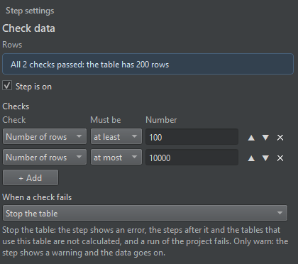

On a day when `orders.csv` has only its header row, the check stops *Orders*. Its exports don't
run, so `orders.xlsx` and `orders.csv` keep the data of the last good run. *Revenue by customer*,
which starts from *Orders*, gets the error too ("Table 'Orders' has an error: …"), and its export
doesn't run either:

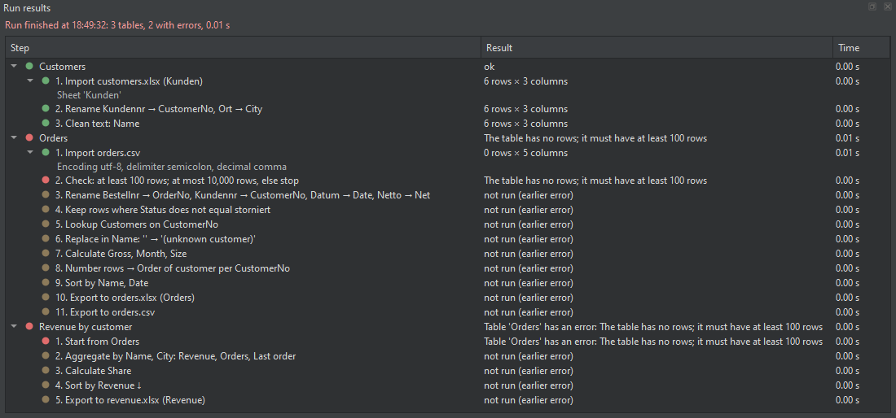

Tips:

- Put the step before the exports, so that bad input never overwrites a good file: right after
  the import to check the input, or just before the exports to check what they would write. A
  check after an export comes too late: the export has already written its file.
- For a daily run ([chapter 11](#11-running-projects-on-a-schedule)), *at least* a number a bit
  below a quiet day stops the table when the input file is empty or suspiciously small, for
  example when another program wrote only half of it. Its exports, and those of the tables that
  use it, keep the files of the last good run; tables that don't use it still run. The run ends
  with exit code 1, so the Task Scheduler shows that it failed.
- *Only warn* is for things to look at that shouldn't stop the run, for example a file that is
  bigger than usual: *at most* `10000` with *Only warn*. **When a check fails** applies to all
  checks of the step: to stop for one check and only warn for another, use two steps.
- **Skip the rest if a table is empty** is for days when no data is normal, **Check data** for
  days when no data is a mistake. A folder import with **When there are no files**: **Skip the
  rest of the table** skips the steps after it, **Check data** too: a day without files is then no
  error. To make it one, leave **When there are no files** at **Stop with an error**
  ([chapter 10](#10-days-without-data-and-a-daily-inbox)).
- The check runs while you edit too: the step turns red (or orange) as soon as the data at it
  fails a check, before any run.

### Columns: names, order, types, pivot and unpivot

**Change type / format** converts columns to another type, or writes dates and numbers as
formatted text.

- **Columns**: rows of **Column**, **New type** (*Text*, *Whole number*, *Decimal number*,
  *Date*, *Date and time*, *True / false*) and **Format**.
- **Decimal separator in text**: *Comma: 1.234,56* or *Point: 1,234.56*, for reading and writing
  numbers as text.
- **Values that can't be converted**: *become empty (with a warning)* or *stop with an error*.

Formats use Excel's codes:

| Column holds | New type | Format | Result |
|---|---|---|---|
| the date 27 February 2026 | Text | `yyyy-mm-dd` | `2026-02-27` |
| the number 1484.42 | Text | `#,##0.00 €` | `1.484,42 €` |
| the whole number 1234 | Text | `00000` | `01234` |
| the text `20260131` | Date | `yyyymmdd` | 31 January 2026 |
| the text `31.12.25` | Date | (empty) | 31 December 2025 |
| the text `1.234,56` | Decimal number | | 1234.56 |
| the whole number 45658 | Date | | 1 January 2025 (Excel's day number) |
| the texts `ja`, `nein` | True / false | | true, false |

Without a format, common date formats are recognized; two-digit years are read as in Excel (00–29
are 20xx). Month names (`mmmm`) are English. The rows of the step are applied one after the other,
so a day number in a text column becomes a date with two rows: *Whole number*, then *Date*. A
warning names what failed, for example "Day: 1 value(s) could not be converted to Date, e.g. 'x'
(now empty)".

**Keep, remove or reorder columns**: **Mode** *Keep only these columns, in this order*, *Remove
these columns* or *Move these columns to the front*, for the ticked **Columns** `*`. Before an
export, *Keep only…* makes sure the file always gets the same columns, even when the source gets
new ones.

**Rename columns** gives columns new names: rows of **Column** and **New name**.

Rename early, right after the import: later steps use the new names. A step that still names the old
one stops with a hint, for example "Conditions, row 1 – Column: column 'Status' not found (did you
mean 'State'?)".

**Pivot** turns the values of one column into columns, like an Excel pivot table without totals.

- **Row keys (empty = one total row)**: one row for each combination of their values, in the
  order they first appear.
- **Column names from** `*`: each value of this column becomes a new column.
- **Values from** `*`: the values that fill the new columns.
- **Function**: how the values of the rows that meet in one cell are combined: *Sum* (the
  default), *Count values (not empty)*, *Average*, *Minimum*, *Maximum*, *First value* or *Last
  value*.
- **Order of the new columns**: *Sorted (A→Z, 1→9)* (the default) or *As they first appear*.

Example: sales by region and month, with **Row keys** Region, **Column names from** Month,
**Values from** Amount and *Sum*:

| Region | Month | Amount |
|---|---|---|
| North | 2026-01 | 10 |
| South | 2026-01 | 5 |
| North | 2026-02 | 7 |
| South | 2026-02 | 20 |
| North | 2026-01 | 1 |
| West | 2026-03 | 3 |

becomes

| Region | 2026-01 | 2026-02 | 2026-03 |
|---|---|---|---|
| North | 11 | 7 | |
| South | 5 | 20 | |
| West | | | 3 |

The two rows of North in 2026-01 are added up: 10 + 1. West has no rows in 2026-01 and 2026-02:
these cells stay empty, not 0. With *Count values (not empty)*, North has 2 in 2026-01. Without
row keys, the result is one total row: 16, 27 and 3.

- The new columns are named after the values, the same on every PC: text as it is, numbers as
  `1234` or `1.5` (`2`, not `2.0`; exact decimals with their decimal places, `2.00`), dates as
  `2025-12-31`, true/false as `true` and `false`. All empty values, also text with nothing but
  spaces, go into one column `(empty)`. A name that the table has already, such as the name of a
  row key, gets a number, and the box at the top of the settings says so: "Two columns would be
  named “Name”: the new one is named “Name (2)”". The number is never the name of another value:
  with the row key `Name` and the values `Name` and `Name (2)`, the value `Name (2)` keeps its
  column, and the value `Name` gets `Name (3)`. A value whose name is free always keeps it; the
  number of a renamed value can change with the values of the day. Values
  that differ only in spaces at the start or end, such as `Köln` and `Köln `, give two columns
  that look alike; the box says so too, and **Clean text** before the step makes them one.
- *Sorted (A→Z, 1→9)* sorts numbers by size (2 before 10), dates by time and text as **Sort**
  does, with `(empty)` last. *As they first appear* keeps the order of the rows, for values that
  don't sort well, such as month names: sort the table by date first.
- *Sum* needs a number column and *Average* a number or date column ("Sum needs a number column;
  “Amount” is text"). *Minimum* and *Maximum* can't compare lists and records (from Parquet
  files or plugins): "“Tags” holds list(string) values, which Minimum can't compare". The other
  functions take any column. *Count values (not empty)* counts the
  values that are not empty; *First value* and *Last value* take the first and last value that is
  not empty. Here, as in **Aggregate**, text with nothing but spaces counts as a value. A sum of
  only empty values stays empty too.
- At most 1,000 new columns: a column with more distinct values, such as an order number or a
  date, stops the step with "… too many new columns (at most 1,000)". Group such values first,
  for example dates by month with a formula. The result has at most 50,000,000 cells (rows ×
  new columns): with many row keys, such as customer and day, fewer new columns fit.

In the picture, a table *Revenue by month* starts from the demo's *Orders*, sorts it by Month and
pivots City into columns, with the sum of Gross: one row per month, one column per city. An empty
cell is a month without orders from that city. The orders of customer 09999, who has no city
(see [Combine](#combine-merge-and-append-tables)), are in the column *(empty)*.

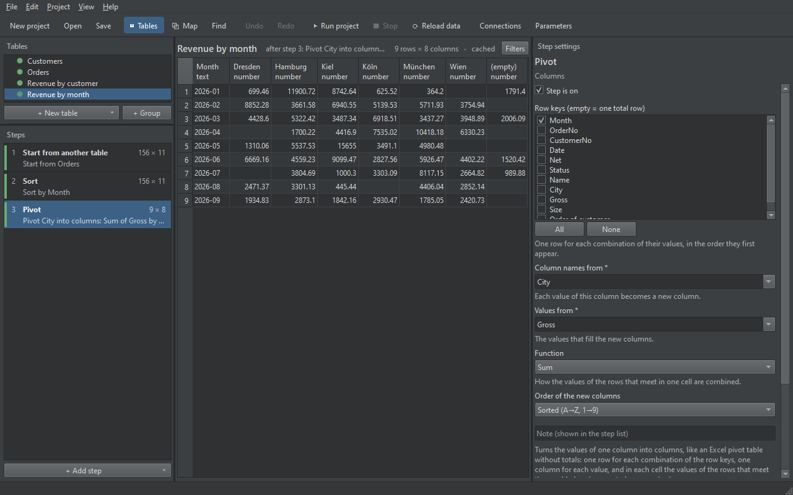

Tips:

- The rows come in the order their keys first appear: sort the table first, as in the picture,
  or sort the result.
- The new columns come from the data. On a day without orders from Kiel, there is no column
  *Kiel*, and a later step that names it stops with an error. On a day without rows, only the row
  key columns are left.
- **Unpivot** turns the new columns back into rows.

**Unpivot** turns columns into rows, the opposite of **Pivot**: each row becomes one row for each
chosen column, with the column's name in a new name column and its value in a new value column.
The other columns are repeated.

- **Turn into rows**: *These columns* (the ticked **Columns** `*`, in the order of the list) or
  *All columns except these* (all columns that are not ticked, in the order of the table).
- **New column for the names** `*` (`Column`): holds the name of the column each value comes
  from. **New column for the values** `*` (`Value`).
- **Leave out empty values** (off) leaves out the rows whose value is empty, also text with
  nothing but spaces. Off, each row gives one row for every column, also for an empty cell.

Example: *All columns except these* with Customer ticked, and the new columns Month and Amount:

| Customer | Jan | Feb | Mar |
|---|---|---|---|
| Huber KG | 100 | 80 | |
| Nord Logistik | 120 | | 95 |

becomes

| Customer | Month | Amount |
|---|---|---|
| Huber KG | Jan | 100 |
| Huber KG | Feb | 80 |
| Huber KG | Mar | |
| Nord Logistik | Jan | 120 |
| Nord Logistik | Feb | |
| Nord Logistik | Mar | 95 |

With **Leave out empty values**, the two rows without an amount are left out: 4 rows. The rows
keep their order, and the values of a row come in the order of the columns. The columns that stay
come first, then the two new ones.

The result has at most 250,000,000 cells (rows × columns). A bigger one stops the step before it
starts: "The result would have … cells (at most 250,000,000). Turn fewer columns into rows, or
remove columns or rows before this step." With **Leave out empty values**, cells without a value
don't count.

The value column keeps the type of the columns when they all have the same. A mix of whole and
decimal numbers becomes decimal numbers, a mix of whole numbers and exact decimals (from a
database's `decimal` or `money` column) becomes exact decimals, and a mix of dates and date-times
becomes date-times, as long as every value stays as it is. Any other mix, also decimal numbers
with exact decimals, becomes text (numbers as `1.5`, exact decimals as `2.00`, dates as
`2025-12-31`), and the step says so, for example "“Value” is text: the columns have different
types (integer: Jan, Feb, Mar; date: Since)". So no value changes without a word: a date never
becomes a number, and true never becomes 1.

Tips:

- Reports from other programs often have a column per month. Unpivot them, and you can filter,
  aggregate and merge by month. *All columns except these* also turns the column of a new month
  into rows, without a change to the step.
- A new column can't have the name of a column that stays: "A column named “Customer” stays in
  the table: choose another name for the new column".

### Text: clean, replace and split

**Clean text** tidies up the chosen **Columns (empty = all text columns)**:

- **Remove spaces**: *at start and end* (default), *at the start*, *at the end*, *nowhere*.
- **Replace repeated spaces with one**, **Replace line breaks with a space** (both off).
- **Upper/lower case**: *keep*, *UPPER CASE*, *lower case*, *Title Case*.
- **Pad to length (0 = off)** with the **Padding character** (`0`): the number 1234 with length 5
  becomes the text `01234`.
- **Make empty text an empty value** (on): a cell left without text becomes an empty cell.

Example: some of the demo's customer names have spaces at the start and end, and several spaces
in a row inside. With **Replace repeated spaces with one** (Customers, step 3), they become
`Müller GmbH` and `Bäckerei Weiß`. Note that *Title Case* makes `GmbH` into `Gmbh`.

**Replace** replaces values **In columns** `*`. **Find**: *Whole cell value*, *Text inside the
value* (every occurrence) or *Regular expression* (**Replace with** can use `$1`, `$2`). The rows
of **Replace** are pairs of **Find** and **Replace with**. **Upper/lower case matters** is on here,
unlike in **Filter rows**.

- *Whole cell value* `offen` → `open`, `storniert` → `cancelled` translates values.
- An empty **Find** finds empty cells: the demo's step 5 writes `(unknown customer)` where Name is
  empty. An empty **Replace with** makes cells empty.
- *Text inside the value* ` GmbH` → (nothing) removes it from the names.
- *Regular expression* `^(\d{2})\.(\d{2})\.(\d{4})$` → `$3-$2-$1` turns the text `27.02.2026`
  into `2026-02-27`.

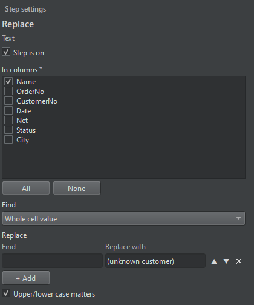

**Split column** splits the text of a **Column** `*` at a separator, into columns or into rows.

- **Into**: *Columns: one new column per part* (the default) or *Rows: one row per part*.
- **Separator**: *Comma ,* (the default), *Semicolon ;*, *Space*, *Tab*, *Line break*, or *Other
  text* with the **Separator text** `*`, for example `/` or `-` (as it is, not a pattern). With
  *Space*, several spaces in a row are one separator. *Line break* splits a cell with several
  lines into its lines.
- **Remove spaces around the parts** (on).
- Into columns: **New columns (one per part)**, a name for each new column. An empty name (it
  shows *automatic*) gives *Name 1*, *Name 2*, … after the column. **Keep the original column**
  (off) keeps the column, with the new columns right after it.

Example into columns: **Column** Name, **Separator** *Comma ,*, and **New columns** Last name and
First name:

| No | Name |
|---|---|
| 1 | Müller, Hans |
| 2 | Schmidt, Anna, Dr. |
| 3 | Weiß |

becomes

| No | Last name | First name |
|---|---|---|
| 1 | Müller | Hans |
| 2 | Schmidt | Anna, Dr. |
| 3 | Weiß | |

The new columns take the place of Name. There are as many parts as new columns: missing parts stay
empty, and the last column gets the rest of the text as it is, with its own spaces and line
breaks. The box at the top of the settings then
says so: "1 value has more parts than there are new columns: the last column has the rest, e.g.
“Schmidt, Anna, Dr.”". With a third row in **New columns**, Dr. gets a column of its own.

Example into rows: **Column** Products, **Separator** *Semicolon ;*:

| OrderNo | Products |
|---|---|
| 10001 | Bread;Cake;Coffee |
| 10002 | Tea |

becomes

| OrderNo | Products |
|---|---|
| 10001 | Bread |
| 10001 | Cake |
| 10001 | Coffee |
| 10002 | Tea |

The column keeps its name and place, and the other columns are repeated. Empty parts are left
out: `Bread;;Cake` gives two rows. A value without any part, such as an empty cell, keeps one row
with an empty value, so no row is lost.

The parts are text, and a part with nothing but spaces is empty. A column that is not text is
turned into text first, as **Pivot** names its columns: a date splits as `2026-02-27`, so *Other
text* `-` and three new columns give 2026, 02 and 27, and a date-time as
`2026-02-27 08:30:00`, so *Space* gives the date and the time. **Change type / format** makes
numbers or dates of the parts.

Tips:

- Codes such as `DE-2026-0017` split with *Other text* `-` into DE, 2026 and 0017: the parts are
  text, so the leading zeros stay.
- A new column can't have the name of a column the table has already: "New columns, row 1: the
  table has a column named “No” already. Give the new column another name."

### Calculate: formulas, numbers and totals

**Aggregate** groups rows with equal values and calculates one row per group, like `GROUP BY` in
SQL.

- **Group by (empty = one total row)**.
- **Calculate**: rows of **Function**, **Column** and **Result name (empty = automatic)**.
  Functions: *Sum*, *Average*, *Minimum*, *Maximum*, *Median*, *Count values (not empty)*, *Count
  distinct values*, *Count rows*, *First value*, *Last value*, *Join texts* (with the **Separator
  for 'Join texts'**).

Without a result name, a column is named like *Sum of Net*. Groups come in the order they first
occur. Example: the demo's *Revenue by customer* (step 2) groups by Name and City: *Sum* of Gross
as `Revenue`, *Count rows* as `Orders`, *Maximum* of Date as `Last order`. *Join texts* of
OrderNo puts the order numbers of a group into one cell: `10037, 10074, 10111, …`.

Tip: to keep every row and add the group's total to it, use a window function in **Calculate
columns** instead: `SUM([Net]) OVER (PARTITION BY [CustomerNo])`.

**Calculate columns** adds columns calculated with formulas: one card per column with **Column
name** and **Formula**. A column that exists already is replaced in its place; each formula can
use the columns of the cards above it. The demo's step 6 calculates Gross, Month and Size.
Formulas: [chapter 5](#5-formulas).

**Number rows** adds a running number in the **New column** `*` (`No`).

- **Numbering**: *Number the rows: 1, 2, 3, …* (with **Groups (columns)**, the numbers start again
  for each group, like `ROW_NUMBER()` in SQL) or *Number the groups: equal values get the same
  number* (each combination of the group columns gets one number, like `DENSE_RANK()`).
- **In this order (empty = current row order)**, **Start at** (`1`) and **Step** (`1`).

The rows stay where they are; only the numbers follow the order. The demo's step 7 numbers each
customer's orders by date: 1 for the first order, 2 for the second, and so on.

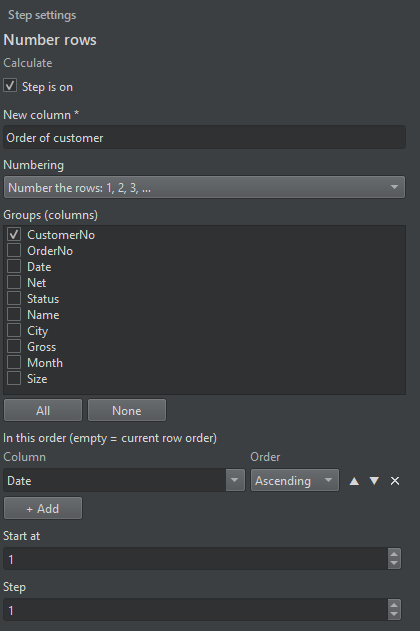

### Combine: merge and append tables

**Append other tables** adds the rows of the ticked **Tables to append below this one** `*` below
this table. **Columns**: *All columns of all tables (missing values stay empty)* or *Only the
columns of this table*. Columns are matched by name; a column with different types in the tables
becomes text.

**Merge with another table** adds columns from another table, or keeps rows, by matching key
columns: a lookup as in Excel, or a join as in SQL.

- **Other table** `*`, and **Match rows where**: rows of **Column in this table** and **equals
  column in the other table** (with several rows, all must be equal).
- **Merge type**: see the table.
- **Columns to add (empty = all)**.
- **If several rows of the other table match** (joins only): *Use all of them, rows repeat (like
  SQL)* or *Use only the first one*.
- **Suffix for column names that exist already** (` (2)`), for example *City (2)*.

What each type does with the demo's 156 orders (after step 3) and its 6 customers; the 4 orders of
customer 09999 have no match:

| Merge type | What it does | Rows |
|---|---|---|
| *Lookup (first match, row count stays)* | adds the columns of the first match; rows without one get empty cells | 156 |
| *Left join (all rows of this table)* | like `LEFT JOIN`: a row repeats when several rows match | 156 |
| *Inner join (only rows with a match)* | only rows with a match | 152 |
| *Full join (all rows of both tables)* | also rows of the other table without a match | 156 |
| *Keep rows with a match* | filters, adds no columns | 152 |
| *Keep rows without a match* | filters, adds no columns | 4 |

*Lookup* and *Left join* differ when the other table has a key twice: with customer 00017 listed
twice, *Lookup* keeps 156 rows, *Left join* gives 172 (each order of 00017 twice).

The step says how many rows matched, in the box at the top of its settings and in Run results.
For the demo's lookup: "152 of 156 rows matched, 4 without a match: 09999". It names up to three
keys of the rows without a match, and how many more there are ("09999, 01234, 05555 and 17
more"), so a wrong key column or missing master data shows at once. The other merge types say it
in their own words, for example *Inner join* "152 of 156 rows matched; 4 without a match were
left out: 09999", and *Keep rows without a match* "4 of 156 rows without a match were kept; 152
matched and were left out". A *Full join* also counts the rows of the other table that it added,
also when this table has no rows. A key of several columns is shown as "(09999, North)".

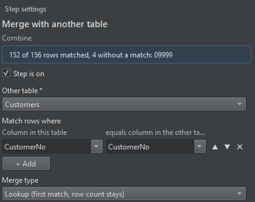

Tips: empty keys never match. A number key and a text key are compared as text (with a warning),
so the number 17 doesn't match the text `00017`: keep such keys as text. *Keep rows without a
match* finds missing master data, for example orders of unknown customers.

### Export: files and databases

Each export to a file or a database table has **Don't export an empty table** (off): when the table
has no rows, the target stays as it is, and the step says "Not exported: the table is empty". A CSV
or Excel file is replaced only when the new one is complete.

**Export to CSV / text file** writes a delimited text **File** `*`.

- **Delimiter** (*Semicolon ;*), **Encoding** (*UTF-8 with BOM (Excel opens it correctly)*) and
  **Decimal separator** (*Comma: 1234,56*).
- **Date format** (`dd.mm.yyyy`) and **Date-time format** (`dd.mm.yyyy hh:mm:ss`).
- **Write column names** (on), **Put every value in quotes** (off).

The defaults give `10001;01001;27.02.2026;82,03;geliefert`, which Excel opens directly with German
regional settings. For a program that wants `2026-02-27` and `82.03`, choose *Point: 1234.56* and
`yyyy-mm-dd`. Decimal numbers get at most 15 significant digits, as in Excel.

**Export to Excel file** writes an `.xlsx` **File** `*` with a **Sheet name**, as an Excel table:
**If the file exists** (*Replace the whole file* or *Replace only this sheet, keep the other
sheets*), header and table style, and formats for dates and numbers, also for single columns.
Details: [chapter 9](#export-a-formatted-excel-file).

**Export to database** writes into a table of a **Connection**: add the rows, replace them all or
those with the same key values, update, or delete, in one transaction. Details:
[chapter 8](#write-into-a-database-table).

**Run SQL command** (in the **Export** menu) runs **SQL** on a **Connection** when the project
runs, for example `EXEC dbo.RefreshReport` after an export, in one transaction
([chapter 8](#run-sql-when-the-project-runs)).

### Files: copy, move, rename and delete

**Copy files**, **Move files** and **Delete files** take their files from:

- **Which files**: *Listed in a column* (the default) or *All files this table's import read*
  (every file that the table's first step, an import of all files of a folder, read; also files
  with only a header row).
- **Column with the files** `*`: full paths (e.g. *Full path* of **Files in a folder**), or paths
  below the folder in **Paths in the column are below** (empty = the project's folder).
- **If a file doesn't exist**: *Stop with an error* or *Skip it*.

**Copy files** and **Move files** put the files **To folder** `*` (created when needed).
**Keep the subfolders of the paths** (off): `2026\02\orders.csv` goes to
`<folder>\2026\02\orders.csv` instead of `<folder>\orders.csv`. **If a file of that name is
there already**: *Keep both: name (2).csv*, *Replace it*, *Leave it, skip this file* or *Stop with
an error*.

**Rename files** gives the files in **Column with the files** the names in **Column with the new
names** `*`; they stay in their folder. Calculate the names first, for example `REPLACE([File],
'.csv', '.done')`.

**Delete files**: **Delete** *To the Recycle Bin (can be restored)* or *For good (can't be
undone)*.

**Create folder** creates a **Folder** `*` with the folders above it.

All files are checked before the first one is changed: a missing file (unless you chose *Skip
it*) or a name that Windows doesn't allow stops the step with nothing changed. The daily inbox in
[chapter 10](#10-days-without-data-and-a-daily-inbox) moves the files it has loaded to an
archive.

## 5. Formulas

Formulas calculate new columns in **Calculate columns**, decide which rows **Filter rows by
formula** keeps, and can give a parameter its value ([chapter 7](#7-parameters)). A formula is
written once and calculated for every row, like an Excel formula filled down a column. It is a
SQL expression, as in a `SELECT`, in the dialect of DuckDB, the database engine inside Tafl. A
formula can only use the data of its step: no files, network or databases.

### Writing a formula

- **Columns** in square brackets: `[Net]`, `[Order of customer]` (needed for names with spaces).
- **Texts** in single quotes: `'large'`; a quote inside is doubled: `'O''Brien'`.
- **Numbers** with a decimal point and no thousands separators: `1000.50`.
- **Dates**: `DATE '2026-01-31'`, or compare a date column with a text in this form:
  `[Date] > '2026-01-31'`.
- **Empty values** are `NULL`: test them with `[City] IS NULL` (`= NULL` is never true).
- **Operators**: `+ - * /`, `=`, `<>`, `<`, `>=`, `AND`, `OR`, `NOT`, `IN ('Hamburg', 'Köln')`,
  `BETWEEN 500 AND 1000`, `LIKE '%GmbH%'`.
- **Comments**: `-- to the end of the line` and `/* … */`. **Parameters**: `{Month}`.

Watch out:

- Texts are compared case-sensitively: `[Status] = 'OFFEN'` is false for `offen`. Write
  `LOWER([Status]) = 'offen'`.
- Join texts with `||` or `CONCAT`, not `+`. `[First] || ' ' || [Last]` is empty when a part is
  empty; `CONCAT([First], ' ', [Last])` treats empty parts as empty text.
- `/` always gives a decimal number (`7 / 2` is 3.5; `7 // 2` is 3). Dividing by zero gives ∞:
  `[Net] / NULLIF([Quantity], 0)` gives an empty value instead.

### Common formulas

| Formula | What it gives |
|---|---|
| `ROUND([Net] * 1.19, 2)` | rounded to 2 decimals: 82.03 gives 97.62 |
| `IIF([Net] >= 1000, 'large', 'normal')` | one of two values |
| `CASE WHEN [Net] >= 2000 THEN 'large' WHEN [Net] >= 500 THEN 'medium' ELSE 'small' END` | the value of the first true condition |
| `ISNULL([City], '-')`, `COALESCE([Phone], [Mobile], '-')` | a value for empty cells |
| `UPPER([Name])`, `TRIM([Name])`, `LEFT([CustomerNo], 2)`, `LEN([Name])` | text |
| `REPLACE([Name], ' GmbH', '')` | the text without ` GmbH` |
| `YEAR([Date])`, `MONTH([Date])` | parts of a date, as numbers |
| `STRFTIME([Date], '%Y-%m')` | the date as text, `2026-02` (`'%d.%m.%Y'` gives `27.02.2026`) |
| `[Date] + 30` | the date 30 days later |
| `LAST_DAY([Date])` | the last day of the month |
| `[Date] + INTERVAL 1 MONTH` | a month later, as a date-time (`CAST(… AS DATE)` for a date) |
| `TODAY() - [Date]` | the days since the date |
| `CAST([OrderNo] AS VARCHAR)` | the value as text; `TRY_CAST` gives empty where it doesn't fit |
| `[Net] / SUM([Net]) OVER ()` | the row's share of the total |
| `SUM([Net]) OVER (PARTITION BY [CustomerNo])` | the customer's total in each of its rows |

The last two are window functions: they look at all rows of the step. A total without `OVER`,
such as `SUM([Net])`, doesn't work in a column formula; for one row per group, use **Aggregate**.
From SQL Server, `IIF`, `ISNULL`, `LEN`, `GETDATE()` and `CHARINDEX` work as there.

### The line under the formula

While you type, the line under the formula shows what it gives on the data going into the step
(the first 1,000 rows). For a column, it shows the type and the first values, for example
`→ number: 97.62, 435.6, 1766.46, … · no errors in all 156 rows`
([Calculate a column](#calculate-a-column) in chapter 2 has a picture). For a condition, it shows
how many rows it keeps: `[Net] >= 1000 AND [City] IN ('Hamburg', 'Köln')` gives
`→ true for 30, false for 123, empty for 3 (counts as false) of all 156 rows` (see the picture
below).

A mistake turns the line red and is underlined in the formula. Click the line to select the
mistake; a link like **Write [Net]** corrects it with one click. Nothing is applied before you
press Enter or leave the field (Shift+Enter starts a new line). Columns, functions, texts, numbers
and comments have their own colors, a `[column]` the step doesn't have is red, and the bracket
matching the one at the cursor is marked.

![A misspelled column: the mistake is underlined, and Write [Net] corrects it with one click](guide/formula-mistake.png)

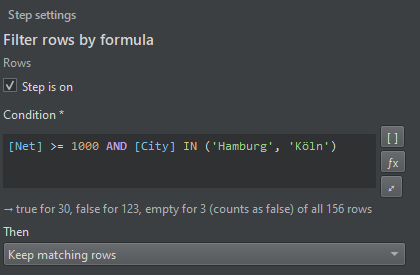

### Suggestions while you type

Type `[` (or click **[ ]**) for a list of the columns with their types; in **Calculate columns**
also the columns of the cards above (*number (row 1)*). After two letters of a word, the list
offers functions, keywords and columns, with a line about the selected function. `{` lists the
parameters with their values. Ctrl+Space opens the list at any time; Enter, Tab or a click writes
the entry in, Esc closes the list.

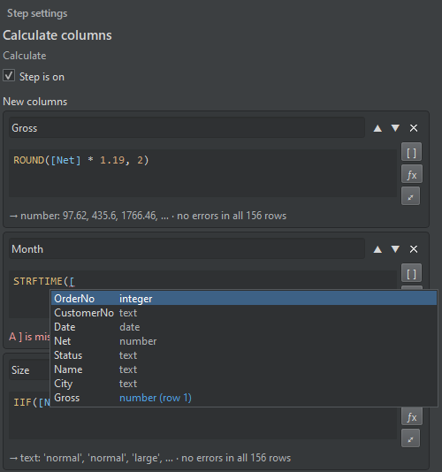

### Formula functions (F1)

**Help → Formula functions** (F1), or **ƒx** next to a formula, lists every function with what it
does, how it is written and an example, in categories from *Conditions* to *More from DuckDB*.
Search by name or by what it does: `month` finds MONTH, MONTHNAME and LAST_DAY. Names from SQL
Server and spreadsheets find what to use instead: `DATEADD` finds `+ INTERVAL`, `EOMONTH` finds
LAST_DAY. **Insert into the formula** (or Enter, or a double-click) writes the function into the
formula field you used last, around selected text if there is any. **Copy the example** copies the
example. The window stays open beside the app; Esc closes it.

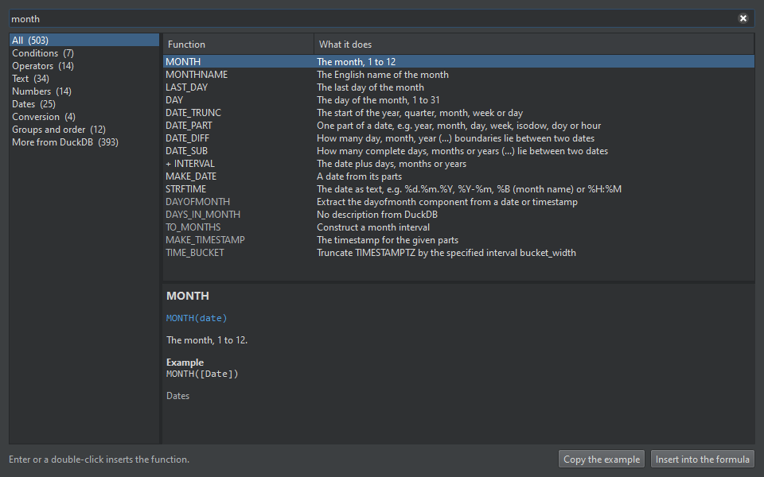

### The formula window for long formulas (F2)

For long formulas, press F2 in a formula field or click **⤢**. The formula window has a big
editor, the tabs **Columns** (double-click or Enter inserts a column) and **Functions**, and below
the editor the result on the first rows, next to the columns the formula uses. Enter starts a new
line, Ctrl+Enter or **Apply** applies, Esc cancels (twice after a change). In the tables list,
F2 renames the table instead.

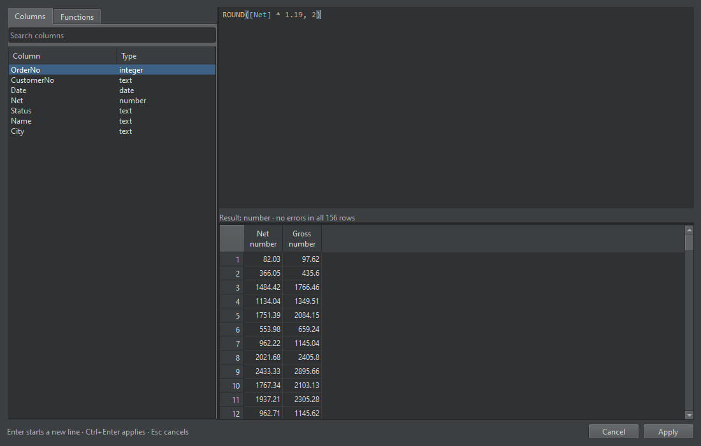

### Common formula mistakes

The line under the formula says what is wrong. A step whose formula is wrong stops with the same
message and the column's name, for example "Formula error in [Gross]: column [Nett] not found (did
you mean [Net]?)".

- `[Name] + ' GmbH'`: the message ends with "to join text use || or CONCAT()".
- `[Status] = "offen"`: "Column [offen] not found": double quotes are for names; texts need single
  quotes.
- `[Net] * 1,19`: "The result is a structure of several values. …": the comma separates values.
  Write `1.19`, and `1000.50` instead of `1.000,50`.
- `ROUND([Net] * 1.19, 2`: "A ) is missing".
- `TODAY`: "TODAY is a function: write TODAY()".
- `DATEADD(day, 3, [Date])`: "There is no function DATEADD: add an interval instead: [Date] +
  INTERVAL 3 DAY (or MONTH, YEAR)". `EOMONTH` and `CONVERT` get such hints too.
- `SUM([Net])`: "The formula must give one value per row. For totals use the Aggregate action, or
  a window function such as SUM([Amount]) OVER ()."
- `[Net] * 2` as a condition: "The condition must be true or false for every row, e.g. [Amount] >
  100 (this formula gives a number)".

## 6. The project map and groups

The table view shows one table at a time. The project map shows all tables at once, and how
they use each other. It is a full workspace: next to the map are the steps, settings and data of
the selected table, so you can build a whole project from here.

### Open the project map

Click **Map** in the toolbar, or press Ctrl+2. **Tables** (Ctrl+1) takes you back.

The map fills the top left. The selected table's steps and step settings are on the right, the
data after the selected step is below the map. Click a box to select its table, then work with
its steps as in the table view. While the map is shown, Tafl calculates every table, so each box
shows whether its table works.

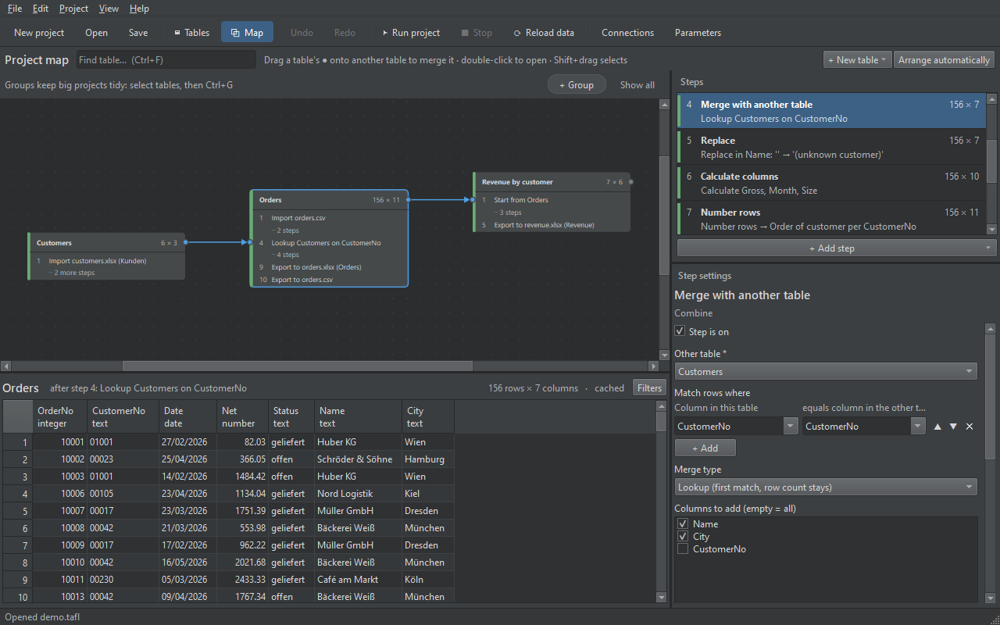

### Read the map

Every table is a box:

- The header has the table's name and the size of its result, for example `156 × 11`, or a word
  instead: **off**, **skipped**, **incomplete**, **waiting**, **error**. The stripe on the left
  has the status color, as in the table view.
- The numbered rows are the steps that matter for the map: the first step, every step that uses
  another table, and the exports and commands. The steps between them are counted, for example
  `⋯ 4 steps`.
- A row that reads from outside the project, an import, ends with **in**; a row that writes or
  changes something outside, an export or a command, ends with **out**. Each has its own color,
  so you see at a glance where data comes in and where it goes out.

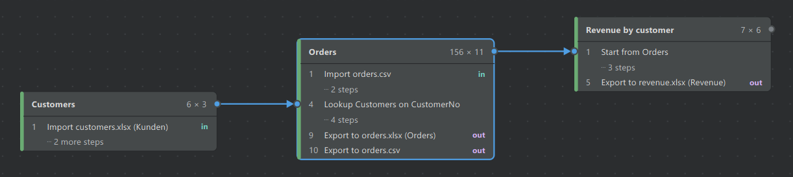

An arrow runs from a table to the step that uses it (**Start from another table**, **Merge with
another table**, **Append other tables**). In the demo, an arrow runs from *Customers* to step 4
of *Orders* (Lookup Customers on CustomerNo), and one from *Orders* to step 1 of *Revenue by
customer*. The arrows of the selected table are blue. A dashed arrow belongs to a step that is
turned off; tables that are off or skipped are drawn pale. Point at a box, a row or an arrow for
a tooltip with more.

To move around, drag the empty background; Ctrl + mouse wheel zooms; **Show all** (or the key 0)
fits the whole project into the window. Drag boxes to arrange them by hand: the arrangement is
saved with the project, and what is in the way moves down, so boxes never pile up. **Arrange
automatically** puts the tables back in columns from left to right, in the order the data flows.

### Connect tables on the map

Instead of adding a merge or append step by hand, drag one table onto another:

1. Point at the ● on the right edge of the header of the table you want to use. The cursor
    becomes a cross.
2. Drag it onto the table that should use it, and let go.
3. Choose from the menu: **Lookup: add columns (first match)**, **Left join**, **Inner join**,
    **Full join**, **Append its rows below**, **Keep rows with a match** or **Keep rows without a
    match** ([chapter 4](#combine-merge-and-append-tables) explains them).
4. The step is added to the table you dropped on, before its exports, and its settings show on
    the right. Check them.

The status bar says what was added, for example "Added step 5 to “Revenue by customer”: Lookup
Customers on Name". As the matching column, Tafl takes a column that both tables have,
preferring names like CustomerNo, ID or Code: check that it is the right one. Without a column in
common, the message ends with "choose the matching columns on the right", and the step stays
*incomplete* until you do.

Dropped on an empty spot, the ● gives a new table that starts from the dragged one, named for
example "Orders (derived)".

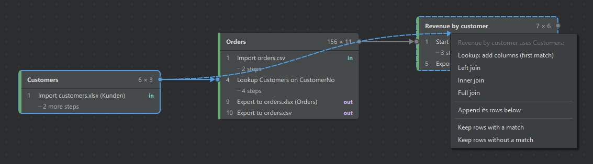

### Arrows and boxes

- **Click an arrow** to select the step it ends at; double-click it to open that step in the table
  view. Right-click it for **Edit this step**, **Turn step off** and **Delete step** (or select it
  and press Del).
- **Double-click a box** to open its table in the table view, or one of its rows to open that
  step.
- **Select several boxes** with Ctrl+click, or hold Shift and drag a rectangle around them.
- **Right-click a box** for its menu. **Add step** adds a step after the table's selected step
  (at the end if none is selected). **Turn table off** and **Delete…** work as in the Tables
  panel ([chapter 3](#the-tables-panel)).

Right-click the empty background for **New table here**: the table appears where you clicked, in
the group whose frame you clicked in.

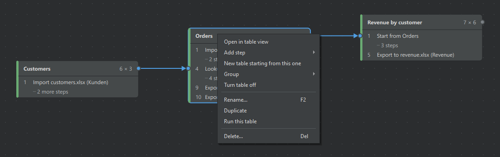

### Group tables

Groups make a big project easier to read, for example *Sources* for the imports, *Reports* for the
exports and *Checks* for tables that look for problems. A group is a colored frame on the map and
a folder in the table list.

1. Select the tables: Ctrl+click them, or Shift+drag a rectangle around them.
2. Press Ctrl+G, or click **+ Group** above the map.
3. Type a name, for example `Checks`, and click **OK**.

The status bar says which key jumps to the new group, for example "Group “Checks” created: press 3
on the map to jump to it".

The **group bar** above the map has a chip per group, for example `1  Sources (3)`. Click a chip, or
press its number (1 to 9), to jump to the group; 0 shows everything again. The keys work anywhere on
the map, but not while you type in a field. A chip that shows `✗ 2` has two tables with errors.

Right-click a chip, or a frame's title, to collapse the group, select its tables, add the selected
tables to it, rename it, change its **Color**, **Turn all its tables off**, or **Ungroup (the
tables stay)**. Drag a box into a frame to add it to the group, or out of the frame to take it
out; drag a frame by its title to move the whole group.

The pictures of this section and the next show a bigger version of the demo: seven tables in the
groups *Sources*, *Reports* and *Checks*.

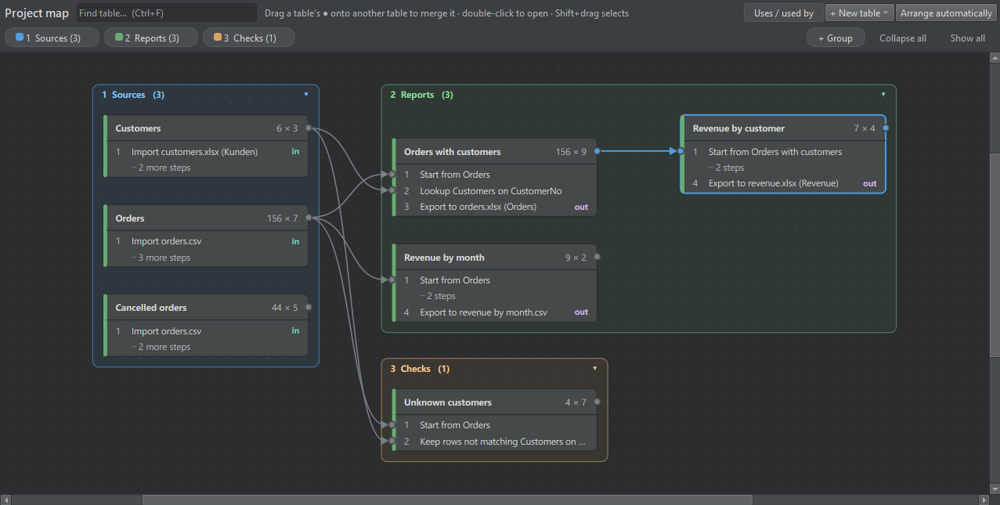

### Collapse groups

Click ▾ at the right of a frame's title, and the group becomes one compact box. It lists only the
tables that are connected to tables outside the group (the arrows end there) and counts the
others (`⋯ 1 more table`). Its header sums up the status: **all ok**, **2 errors**, **all off**.
A line at the bottom counts the imports and the exports and commands of its tables, for example
`3 in · 2 out`. **Collapse all** in the group bar does this for every group: an overview of a big
project.

Double-click the header of a collapsed box (or click **Expand all**) to see the tables again.
Click a row to select that table; double-click it to open the table. Collapsed groups are saved
with the project.

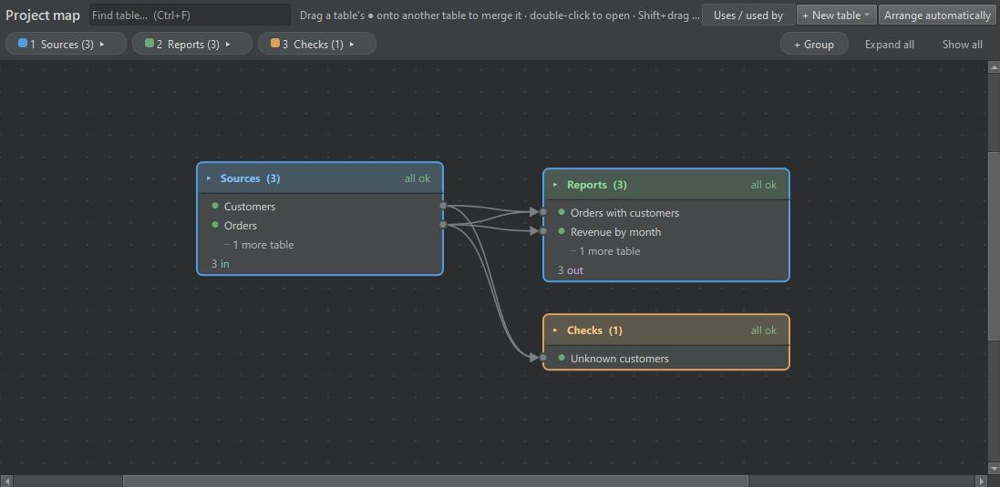

### What a table uses and what uses it

Click a box and press H, or click **Uses / used by** above the map, or right-click the box and
choose **Show what it uses and what uses it**. The tables it uses, directly or through other
tables, get a teal border, the tables that use it a violet one, and the arrows between them the
same colors. The other tables and arrows are dimmed. The status bar says, for example,
"“Orders with customers” uses 2 tables and is used by 1 · H or Esc ends the highlight".

The highlight follows the selection: click another box to see what that table uses. H again,
Esc or the button ends it. Steps that are turned off don't count, as in the calculation: turn a
step off, and its arrow leaves the highlight at once. In a collapsed group, a bar in the same
colors marks the rows of the highlighted tables; on the row `⋯ 2 more tables`, the bar is for
highlighted tables that the box doesn't list (its tooltip names them). Tables that the selected
table uses and that use it too, a circular reference, get a red border, and the status bar says
"… a circular reference with 2 of them".

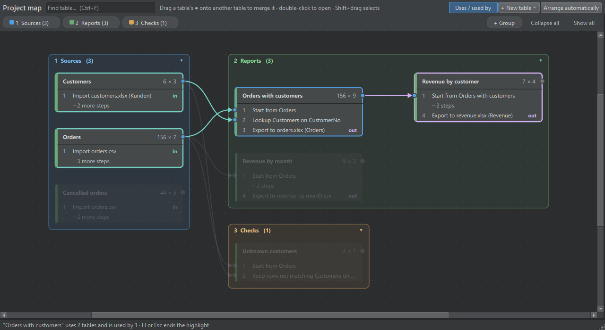

### Find a table on the map

Press Ctrl+F anywhere on the map and type a part of a name. Matching tables get an orange
border; Enter jumps to the next one ("Table 1 of 3 containing “order” · Enter: next one"), and
opens a collapsed group if the table is in it. Esc clears the search and the selection and
takes you back to the map (so does **✕** at the end of the field, for the search). To find steps,
files, SQL or formulas instead, use the [Find panel](#the-find-panel) (Ctrl+Shift+F).

Other keys on the map: F2 renames the selected table, Del deletes the selected tables (after
asking) or the step of the selected arrow. Ctrl+Z undoes all of it.

## 7. Parameters

A parameter is a value the whole project uses, such as the day or month a report is for. You
define it once and write `{Name}` where a step needs it: in a file name, a filter, a formula or a
SQL query. For another month you change one value, or give it on the command line.

The example is a monthly report. Its table **Orders of the month** imports `orders.csv`, renames
its columns as in [chapter 2](#rename-the-columns), keeps the orders of one month that are not
cancelled, marks the large ones and exports them to an Excel file named after the month. Its
steps:

1. **Import CSV / text files**: `data/orders.csv`.
2. **Rename columns**: Bestellnr → `OrderNo`, Kundennr → `CustomerNo`, Datum → `Date`, Netto →
    `Net`.
3. **Filter rows by formula**: the orders of the month that are not cancelled (see
    [Use a parameter in a setting](#use-a-parameter-in-a-setting)).
4. **Calculate columns**: `Size` = `IIF([Net] >= {Limit}, 'large', 'normal')`.
5. **Export to Excel file**: `output/orders {Month}.xlsx`, sheet `{Month}`.

### Define parameters

1. Click **Parameters** in the toolbar, or choose **Project → Parameters…**.
2. Click **+ Add** and type a **Name**, for example `Day`.
3. Double-click the cell in **Value (fixed, or =formula)** and type the value, for example
    `2026-03-31`.
4. **Value now** shows the value and its type, "2026-03-31 (date)", or what is wrong.
5. Click **OK**. The tables are calculated again with the new values.

The example has three parameters: `Day` = `2026-03-31`, `Month` = `=STRFTIME({Day}, '%Y-%m')`
(gives `2026-03`) and `Limit` = `1000`. (`Day` is fixed because the example data ends in September
2026; a daily report uses a formula, see below.)

A name has letters A–Z, digits, `_` and spaces, and starts with a letter or `_`. Upper and lower
case don't matter where you use it.

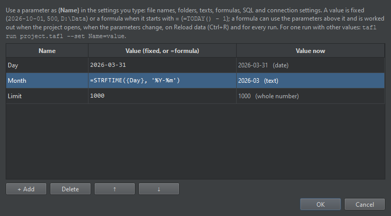

### Fixed values and formulas

A fixed value gets its type from how it is written:

| You type | Type |
|---|---|
| `2026-03-31` | date |
| `2026-03-31 08:30` | date-time |
| `1000`, `-5` | whole number |
| `2.50` | number |
| `D:\Reports` | text |

Write dates as year-month-day and numbers with a decimal point: `31.03.2026` and `1.000,50` are
texts.

A value that starts with `=` is a formula ([chapter 5](#5-formulas)), without columns: it can use
the parameters above it as `{Day}`. **↑** and **↓** change the order.

| Value | Gives |
|---|---|
| `=TODAY() - 1` | yesterday |
| `=STRFTIME({Day}, '%Y-%m')` | the month of `Day` as text: `2026-03` |
| `=LAST_DAY({Day})` | the last day of that month |
| `=STRFTIME(NOW(), '%Y-%m-%d %H-%M')` | date and time as text, for a file name |

Formulas are worked out when the project opens, when you click **OK** in the dialog, on **Reload
data** (Ctrl+R) and at the start of every run. In between, the values stay as they are, so
`=NOW()` doesn't change with every edit. A formula may take 5 seconds at most.

### Use a parameter in a setting

Write `{Name}` in settings you type: file names, folders, texts, column names, formulas and SQL,
also in connection settings. Numbers (such as **Skip lines at the top**), choices and checkboxes
take no parameters.

**File names, folders and texts** get the value as text. The example's export writes to **File**
`output/orders {Month}.xlsx`, **Sheet name** `{Month}`: the run writes `orders 2026-03.xlsx` with
the sheet `2026-03`. The step list keeps showing `{Month}`; the run's message has the real name.
Windows file names can't contain `:`, so take a time without colons, as `=STRFTIME(NOW(),
'%Y-%m-%d %H-%M')` above. A value in **Filter rows** works too: Date **is greater than or equal
to** `{Day}`.

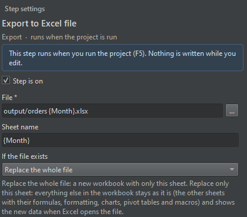

**Formulas** get the value with its type: `[Date] = {Day}` compares dates, `[Net] >= {Limit}`
numbers. The example filters with **Filter rows by formula**:

```
STRFTIME([Date], '%Y-%m') = {Month} AND [Status] <> 'storniert'
```

Inside quotes and brackets the value is text: `'Report {Month}'` gives `Report 2026-03`, and
`[Net {Month}]` is the column "Net 2026-03". Typing `{` in a formula lists the parameters with their
values, and the line under the formula uses them: here "→ true for 17, false for 183 of all 200
rows".

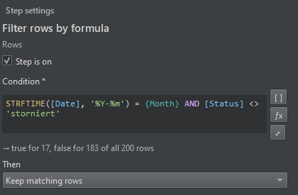

**SQL** gets the value written for the database: on SQL Server, `WHERE OrderDate = {Day}` becomes
`WHERE OrderDate = CAST('2026-03-31' AS date)`, and a text gets its quotes. A parameter can't
stand for a table or column name in SQL. The README has the details for SQL Server, for example for
`EXEC` ([Parameters](../README.md#parameters)).

In formulas and SQL (outside quotes and brackets), `{Name}` stands for a whole value: don't
attach it to other letters. `Sales_{Limit}` gives `Sales_ 1000`, not a name `Sales_1000`. In file
names and texts the value is pasted into the text: `sales_{Month}.xlsx` gives
`sales_2026-03.xlsx`.

### A report for yesterday

For a report that runs every morning for the day before, set `Day` to `=TODAY() - 1` and `Month`
to `=STRFTIME({Day}, '%Y-%m')`. On 1 April, `Day` is 31 March, so the first run of a month still
makes the report of the month before.

### Other values for one run

Give other values on the command line with `--set`; the project file stays as it is:

```
tafl.exe run monthly.tafl --set Day=2026-02-28
tafl.exe run monthly.tafl --set "Day==TODAY() - 7" --set Limit=2000
```

`Day==TODAY() - 7` sets `Day` to the formula `=TODAY() - 7`. Formulas below use the new value:
with `Day=2026-02-28`, `Month` is `2026-02`. The run first lists the values it used
(`{Day} = 2026-02-28` …). A name that is no parameter stops it ("Error: The project has no
parameter 'Foo' (its parameters: Day, Month, Limit)"). In a batch file, write `%` as `%%`
([chapter 11](#11-running-projects-on-a-schedule)).

### Rename a parameter, and mistakes

Renaming a parameter in the dialog renames it everywhere: in the steps, the connections and the
other parameters. Deleting one leaves `{Name}` in the settings, which then shows one of these
messages:

| Message | What to do |
|---|---|
| "There is no parameter {Dy} (Project → Parameters lists them)": a formula fails | Correct the name, or add the parameter. |
| "{Mnth} is not a parameter of the project: it was left as it is": a warning in other settings | The same. |
| "The parameter {Month} has an error: …": a step that uses it fails | **Value now** in the dialog shows the error. |
| "Error: column [Day] not found" in **Value now** | In a parameter's formula, write `{Day}`, not `[Day]`. |

Other braces stay as they are: `\d{4}` in a pattern is no parameter.

## 8. Databases

Tafl works with Microsoft SQL Server and SQLite:

- **Import from database** starts a table with a database table, a view or a SQL query.
- **Export to database** writes a table into a database table.
- **Run SQL command** runs SQL when the project runs.

All three use a **connection**, which says where the database is. Connections are saved with the
project. The example uses a SQLite file, `data/shop.sqlite`, with the tables `customers` and
`load_log`. It is not in the download, but Tafl can make it: see
[Make the example database](#make-the-example-database).

### Define a connection

1. Click **Connections** in the toolbar, or choose **Project → Connections…** (or **Edit…** next to
    a step's **Connection**).
2. Click **+ Add** and choose **Microsoft SQL Server** or **SQLite**.
3. Give it a **Name**, for example `Shop`: the steps use this name.
4. Fill in the settings (below) and click **Test connection**. Below the button you see
    "Connected — 2 tables and views", or what went wrong (you can copy the message).
5. Click **OK**.

Renaming a connection renames it in the steps too.

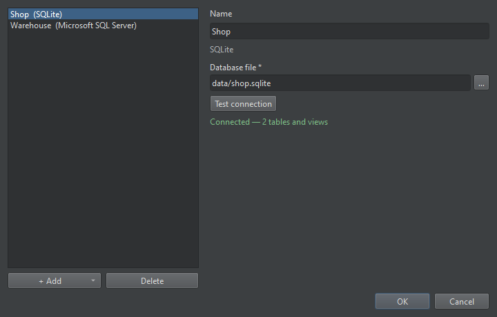

**SQLite**: **Database file** is the file, for example `data/shop.sqlite` (**…** to pick it). If the
file doesn't exist yet, imports and the test say "SQLite file not found: …"; an export creates it.

**SQL Server**:

- **Server**: for example `.\SQLEXPRESS` (SQL Server Express on this PC) or `SERVER01\SALES`.
- **Database**: for example `Sales`.
- **ODBC driver**: leave it empty, and Tafl takes "ODBC Driver 18 for SQL Server" or 17. Without
  one, the test says what to install. Windows' own driver "SQL Server" is used only if you enter it
  here; it reads dates as text.
- **Trust the server certificate**: on by default.

Tafl signs in with your Windows account: no password is entered or stored, and you can read and
change what your account may. A scheduled run uses the account of the task. A failed test shows
the message of SQL Server's driver, often in the language of Windows.

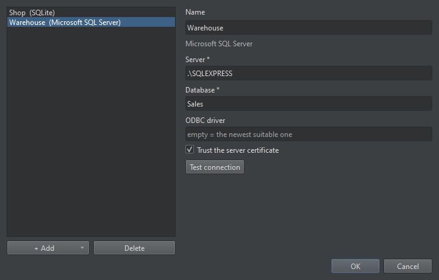

### Make the example database

To follow the examples of this chapter, let Tafl make `data/shop.sqlite`. Save a project in a
folder that has `customers.xlsx` in its subfolder `data`, as in
[chapter 2](#2-your-first-project-step-by-step).

1. Add the connection `Shop`: **SQLite**, **Database file** `data/shop.sqlite` (type it: the file
    doesn't exist yet).
2. Make a table that imports `customers.xlsx` as in
    [Bring in the customer names](#bring-in-the-customer-names): **Row with the column names**
    `3`, **Rename columns** (Kundennr → `CustomerNo`, Ort → `City`) and **Clean text** on Name
    with **Replace repeated spaces with one**.
3. Add **Export → Export to database**: **Connection** `Shop`, **Table** `customers`, **What to
    do**: **Replace all rows (delete them all, then add)**.
4. Add **Export → Run SQL command**: **Connection** `Shop`, **SQL**
    `CREATE TABLE IF NOT EXISTS load_log (Loaded TEXT, Rows INTEGER)`.
5. Run this table (Shift+F5).

The export creates the file and the table `customers` with the 6 customers ("Created table
customers", "customers: added 6 rows"), and the command adds the empty table `load_log`. Now
**Test connection** says "Connected — 2 tables and views".

### Read a table or a query

**+ New table → Import from database**:

- **Connection**, for example `Shop`.
- **Read**: **A table or view** (its name in **Table**, e.g. `customers` or `dbo.Orders`), or **A
  SQL query** in the database's own SQL (T-SQL for SQL Server). Ctrl+Enter applies the query.
- **Detect numbers and dates in text columns**: for databases that keep dates as text, as SQLite
  does.

The example's table **Customers** reads 5 of the 6 customers:

```sql
SELECT CustomerNo, Name, City
FROM customers
WHERE City <> 'Wien'
```

Filter big tables in the query: only the rows you need are read. Imports run while you edit, so
Tafl rolls back whatever a query changes (on SQL Server, a query that commits by itself keeps its
changes). Numbers keep all their digits.

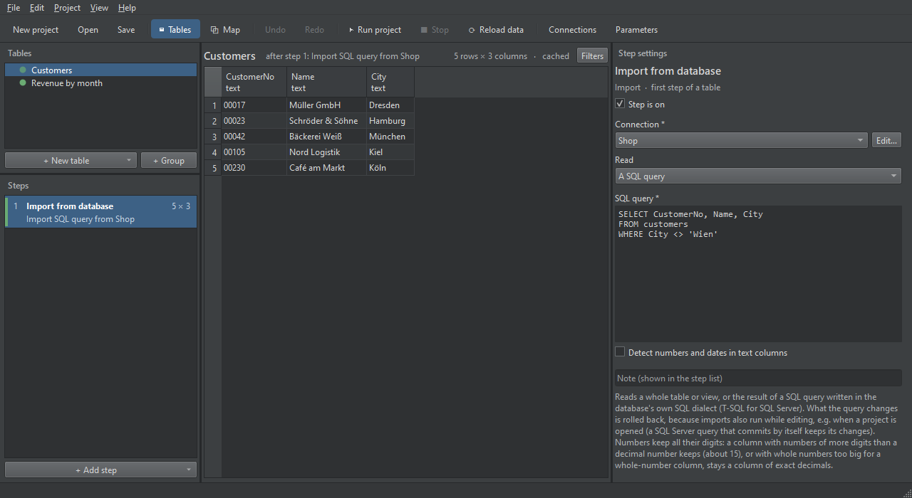

### Write into a database table

The step **Export → Export to database** runs only when you run the project, in one transaction:
if anything fails, the database stays as it was.

| What to do | What happens |
|---|---|
| **Add the rows** | adds all rows |
| **Replace all rows (delete them all, then add)** | the database table gets exactly these rows |
| **Replace the rows with the same key values (e.g. the same dates)** | e.g. key Month: the months in the data are deleted, then added |
| **Delete the rows where a condition is true, then add** | the condition in **Delete the rows where**, in the database's SQL, e.g. `[Date] = CAST(GETDATE() AS date)` |
| **Update the rows with the same key values** | changes the other columns, adds nothing |
| **Update the rows with the same key values, add the others** | updates, and adds the new keys |
| **Delete the rows with the same key values** | only deletes |

- **Connection** and **Table**: where the rows go, for example `Shop` and `revenue`. A table that
  doesn't exist yet is created by the first run (see below).
- **What to do**: see the table above.
- **Key columns** identify a row, for example OrderNo, or Date to replace whole days.
- **Create the table if it doesn't exist** (on by default) creates it with fitting column types.
- **Columns the database table doesn't have**: **Stop with an error**, or **Leave them out**.
- **Don't export an empty table**: nothing changes when the table has no rows. Turn it on with
  *Replace all rows*, which would otherwise empty the database table.

Columns are matched by name, without regard to upper and lower case.

The example's table **Revenue by month** adds up the orders per month and exports them to the
table `revenue`, replacing the rows with the same Month. The first run says "Created table
revenue" and "revenue: added 9 rows"; every later run "revenue: deleted 9 rows, added 9 rows".
Months are replaced, never doubled. How values are stored (types, time zones, collations) is in
the README ([Exporting to a database](../README.md#exporting-to-a-database)).

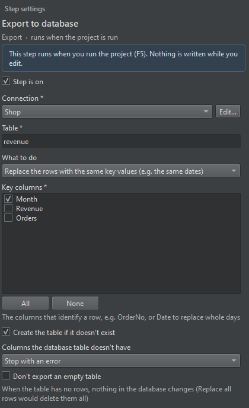

### Run SQL when the project runs

**Export → Run SQL command** runs any SQL when the project runs: a stored procedure after an
export (`EXEC dbo.RefreshReport`), a `DELETE` or an `UPDATE`. The table passes through unchanged.
The example's last step notes each load ("Done: 1 row changed"):

```sql
INSERT INTO load_log (Loaded, Rows)
SELECT datetime('now', 'localtime'), COUNT(*) FROM revenue
```

- It runs in one transaction: leave out `BEGIN` and `COMMIT`.
- On SQL Server, separate batches with `GO` lines as in SQL Server Management Studio; `GO 3`
  runs a batch three times.
- Put it after the export it belongs to. When a step fails, the steps after it don't run.

Before you run a project from someone else, look at its database exports and SQL commands
([Projects from other people](#projects-from-other-people)).

## 9. Excel and files

The settings of every import and export are listed in [chapter 4](#4-actions), the Excel import
with title rows, merged cells and formulas too. This chapter shows the formatted Excel export,
how to replace one sheet of a workbook, and how to read all files of a folder.

### Export a formatted Excel file

**Export → Export to Excel file** writes the table as an Excel table, with a bold and frozen
header row, filter buttons and fitting column widths (each can be turned off), and an optional
**Table style** with banded rows. The table is named after the sheet.

Formats use Excel's codes. **Date format**, **Date-time format**, **Whole number format** and
**Decimal number format** apply to all columns of a type; **Formats for single columns** to one
column, for example Net as `#,##0.00 €` or a share as `0.0%`. The cells keep real numbers and dates,
and Excel shows them with the separators of your Windows settings. The demo exports its orders this
way:

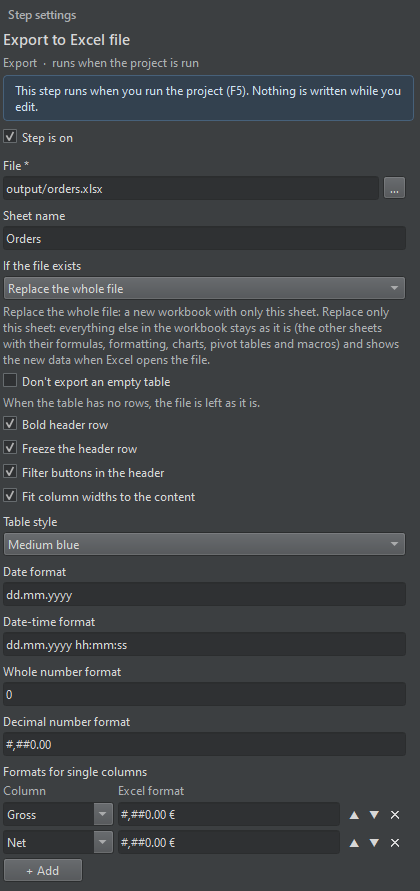

- **Close the file in Excel before you run the project.** Otherwise the export stops with
  "orders.xlsx is open in another program (e.g. Excel): close it and run again".
- The new file replaces the old one only when it is complete: if an export fails, the old file
  stays as it was. A missing folder is created.
- A sheet holds 1,048,575 rows below its header: a bigger table stops the export (filter it, or
  export to CSV). Texts longer than 32,767 characters are cut, with a warning.
- A sheet name has at most 31 characters, without `[ ] : * ? / \`.

### Replace only one sheet

A report workbook often has a data sheet and other sheets with formulas, charts and pivot tables
built on it. With **If the file exists**: **Replace only this sheet, keep the other sheets**, the
export writes only its sheet; everything else in the workbook stays as it is.

The example is `examples\excel-check.tafl` in the Tafl folder. Its table *Data* keeps the orders
above 500 (161 rows) and exports them to the sheet *Data* of `output/excel-check.xlsx`.

1. Run the export once. When the file doesn't exist yet, it is created with this one sheet.
2. In Excel, build the report on other sheets. Use the Excel table in formulas, for example
    `=SUM(Data[Net])`, and as the source of pivot tables: it always has all the rows. Save and close.
3. Every run now replaces only the sheet *Data* ("Wrote 161 rows to sheet 'Data' of … (sheet
    replaced, the other sheets are kept)").

- The sheet keeps its name, place and tab color, and its Excel table keeps its name. A sheet that
  doesn't exist yet is added as the last one.
- Charts, named ranges and pivot tables over the old rows are set to the new rows. Fixed ranges
  in formulas, such as `=SUM(Data!C2:C500)`, stay as they are: use the table or whole columns.
- Excel recalculates the formulas and refreshes the pivot tables when it opens the file.
- What the replaced sheet itself holds goes with it, for example its own charts and comments (the
  step warns). A sheet with its own pivot tables or slicers isn't replaced at all: move them to
  another sheet.
- A `.xlsm` workbook with macros works too, as long as it exists.

Tafl's tests check this with LibreOffice, not with Excel: check your report in Excel before you
rely on it. [A ten-minute check in Excel](excel-check.md) lists what to look at.

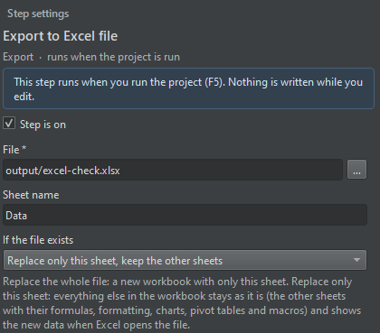

### All files of a folder

The CSV, Excel and Parquet imports can read all files of a folder, and of its subfolders, into
one table. The example folder `exports` has a file per month, `2026\01\orders_2026-01.csv` to
`2026\09\orders_2026-09.csv`:

1. **+ New table → Import CSV / text files**.
2. **Read**: **All files in a folder**; **Folder**: `exports`.
3. **File names**: `orders_*.csv` (`*` stands for any text; several patterns with `;`).
4. Tick **Include subfolders (all levels)** and **Add a column with the path below the folder**.

The table has the rows of all files; in the picture, the 200 orders of the nine files. The
columns **File** and **Path** come first and say where each row came from.

To try it yourself, make the folders `exports\2026\01` and `exports\2026\02` next to your project
file, and copy `examples\data\orders.csv` into them as `orders_2026-01.csv` and
`orders_2026-02.csv`. The table then has 400 rows, 200 from each file.

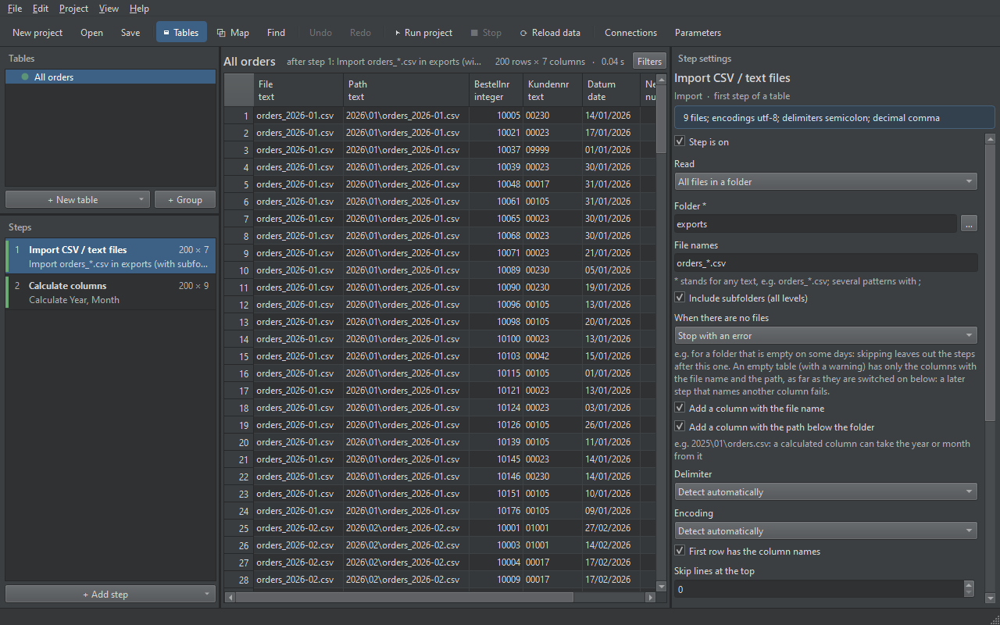

- Files are read in name order, with numbers in natural order (`day2` before `day10`). Names
  starting with `~$` are left out: Excel's lock files and files an export is still writing.
- Columns are matched by name; a column a file doesn't have stays empty in its rows.
- New, changed or deleted files are noticed: the table is read again.
- For Excel files, the column **Sheet** names the sheet when several are read.

Calculated columns take more from **Path** and **File**:

| Formula | Gives |
|---|---|
| `SPLIT_PART([Path], '\', 1)` | the year folder, `2026` |
| `SPLIT_PART([Path], '\', 2)` | the month folder, `01` |
| `TRY_CAST(REGEXP_EXTRACT([File], '\d{4}-\d{2}-\d{2}') AS DATE)` | the date in a name like `orders_2026-02-17.csv` |

A folder without matching files stops the import with "No files named orders_*.csv in …". For a
folder that is empty on some days, choose what happens in **When there are no files**
([chapter 10](#10-days-without-data-and-a-daily-inbox)).

To list the files of a folder without reading them, for example to check what arrived, start a table
with **Files in a folder** ([chapter 4](#imports-the-first-step-of-a-table)).

## 10. Days without data and a daily inbox

Many jobs work on files that another program drops into a folder every day. Some days nothing
arrives, and some files have no rows. This chapter builds such a project and shows the three
options for those days.

### The daily inbox example

A program writes each day's orders into a folder `inbox`: `orders_2026-02-17.csv`,
`orders_2026-02-20.csv` and so on, with the columns of `orders.csv` from
[chapter 2](#2-your-first-project-step-by-step). The project reads all files in `inbox`, leaves
out the cancelled orders, writes the rest to an Excel file, and moves the files it read into a
folder `archive`, so that the next run doesn't read them again. A second table, *Large orders*,
writes the orders of 2,000 or more to a CSV file.

The project is `C:\Reports\daily-inbox\inbox.tafl`, with the folders `inbox` and `archive` next
to it. In the pictures, `inbox` holds three days with orders and one file with only its header
row: 11 orders, 8 after the filter, 4 of them large. To try it yourself, copy
`examples\data\orders.csv` into `inbox` under a name such as `orders_2026-02-17.csv`.

### Import the inbox

1. Start a new project (Ctrl+N) and save it as `inbox.tafl` in `C:\Reports\daily-inbox`
    (**File → Save as**), so that the folders are stored relative to it.
2. **+ New table** → **Import CSV / text files**, **Read**: **All files in a folder**.
3. **Folder**: `inbox`. The table takes the folder's name: rename it to `Daily orders` (F2).
4. **File names**: `orders_*.csv` (`*` stands for any text).
5. **When there are no files**: **Skip the rest of the table**.
6. Add **Rename columns** (Bestellnr → `OrderNo`, Kundennr → `CustomerNo`, Datum → `Date`,
    Netto → `Net`) and **Filter rows** (Status **does not equal** `storniert`), as in
    [chapter 2](#2-your-first-project-step-by-step).

All files become one table, read in name order. The first column, *File*, says which file a row
came from (**Add a column with the file name** is on by default).

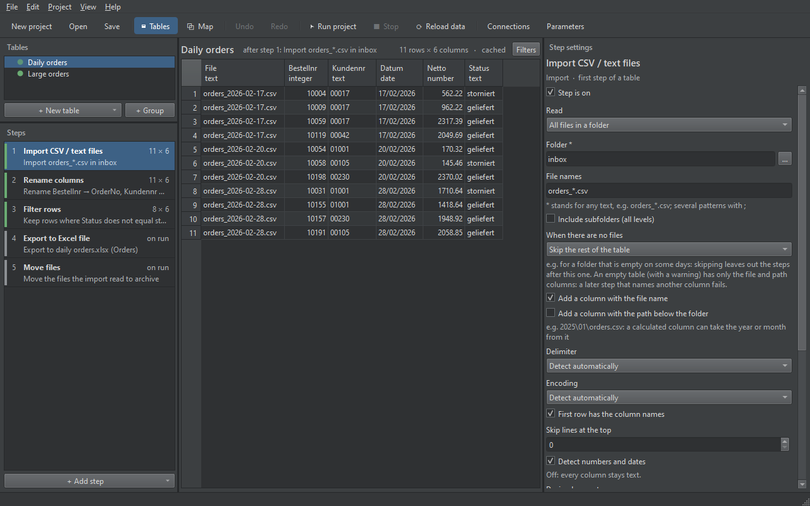

**When there are no files** decides what happens on a day when no file matches:

| Choice | On a day without files |
|---|---|
| **Stop with an error** (the default) | The import fails with "No files named orders_*.csv in …": the table is red, and a run fails. |
| **Continue with an empty table** | An empty table, with a warning. It has only the column *File* (and *Path*, if that column is switched on), so a later step that names another column fails, here *Rename columns* ("column 'Bestellnr' not found"). |
| **Skip the rest of the table** | An empty table, and the steps after the import are skipped, also the exports and file commands. This is not an error. |

A folder that doesn't exist is always an error ("Folder not found: …"), whatever you choose: a
misspelled folder never passes for a quiet day.

### Export, then move the files

1. **+ Add step** → **Export** → **Export to Excel file**: **File** `output/daily orders.xlsx`,
    **Sheet name** `Orders`, and switch on **Don't export an empty table**.
2. **+ Add step** → **Files** → **Move files**: **Which files**: **All files this table's import
    read**; **To folder**: `archive`; **If a file of that name is there already**: **Keep both:
    name (2).csv** (the default: a file that comes a second time is kept as
    `orders_2026-02-21 (2).csv`).

**All files this table's import read** takes every file the import read, also a file with only a
header row or one whose rows the filter removed. Otherwise such a file would stay in `inbox` and
be read again every day. Keep the move in the table that imports the files: other tables don't
know which files the import read.

The move comes after the export. If the export fails, for example because the Excel file is open,
the move doesn't run, and the files stay in `inbox` for the next run. A file that arrives during
the run stays there too. While you edit, the move says **on run**, like the exports: it runs only
when you run the project.

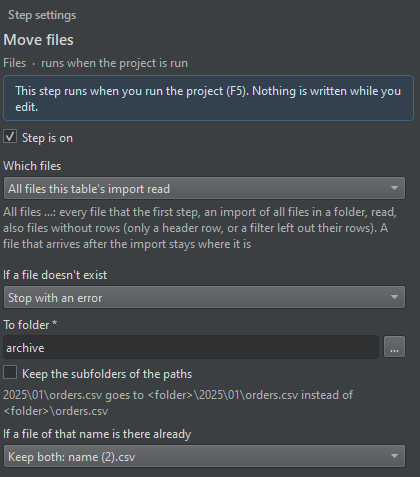

Tips:

- To keep one Excel file per day instead of replacing it, put a parameter into the file name
  ([chapter 7](#7-parameters)): a parameter `Today` = `=TODAY()` and the file
  `output/daily orders {Today}.xlsx` give `daily orders 2026-10-21.xlsx`.
- If the import reads subfolders, switch on **Keep the subfolders of the paths** in the move:
  `2026\02\orders.csv` then goes to `archive\2026\02\orders.csv`.

### A second table for large orders

1. **+ New table** → **Start from another table**, **Table**: *Daily orders*. Rename the table to
    `Large orders`.
2. **+ Add step** → **Rows** → **Filter rows**: Net **is greater than or equal to** `2000`.
3. **+ Add step** → **Rows** → **Skip the rest if a table is empty** (see
    [A day without rows](#a-day-without-rows)).
4. **+ Add step** → **Export** → **Export to CSV / text file**: **File** `output/large orders.csv`.

Save the project (Ctrl+S).

### Run the inbox project

Press F5 (**Run project**). With the files of the pictures, *Daily orders* says in **Run
results** "Wrote 8 rows to C:\Reports\daily-inbox\output\daily orders.xlsx (sheet 'Orders')" and
"Moved 4 files to C:\Reports\daily-inbox\archive", and *Large orders* wrote 4 rows (with a copy
of `orders.csv`, the counts are bigger). `inbox` is empty now.

Right after the run, the window shows what a day without files looks like. The import of *Daily
orders* shows `0 × 1` (only the *File* column), and the steps after it are grey and say
**skipped**. The data panel and the step's settings say why: "skipped: no files named
orders_*.csv in C:\Reports\daily-inbox\inbox". The table's dot stays green: this is not an error.
*Large orders* skips its steps too, because the table it starts from has no data.

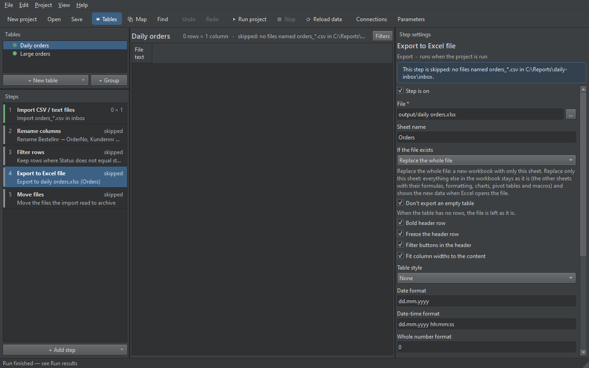

### A day without files

Press F5 again while `inbox` is empty. The run succeeds: "Run finished at …: 2 tables, no
errors". *Daily orders* shows "ok, rest skipped: no files named orders_*.csv in …". Its export and
its move didn't run, so `daily orders.xlsx` keeps the orders of the last day that had files.
*Large orders* shows "ok, rest skipped: the table “Daily orders” has no data (its rest was
skipped)": a table that starts from, merges or appends such a table skips its rest too.


On the command line, the skipped steps have a `–`, and the run ends with exit code 0, so a
scheduled run ([chapter 11](#11-running-projects-on-a-schedule)) doesn't report an error on a
quiet day.

### A day without rows

Sometimes files arrive, but the table has no rows: the files have only a header row, or the
filter leaves nothing. Two options help:

- **Don't export an empty table** (in every export, off by default): when the table has no rows,
  this export leaves the file or database table as it is, and the step says "Not exported: the
  table is empty". The steps after it still run, so the move still archives a header-only file.
  Without the option, the export writes a file with only the header row.
- **Skip the rest if a table is empty** (a step under **Rows**): when the table has no rows at this
  step, the steps after it are skipped. **Which table**: **This table (the data at this step)**, or
  **Another table**, for example to export a customer list only on days when *Daily orders* has
  rows.

An example: a file `orders_2026-02-21.csv` with one order below 2,000 arrives (in the picture,
an order of 962,71), and you press **Reload data** (Ctrl+R). In *Large orders*, the filter leaves
0 rows, step 3 says "The steps after this one are skipped: the table is empty.", and the export
is skipped. A run shows "ok, rest skipped: the table is empty".

To try it, copy `examples\data\orders.csv` into `inbox` as `orders_2026-02-21.csv`, open the copy
in Notepad, and delete all lines after the second: the header and an order of 82,03 are left.
Save it, then press Ctrl+R.


Where people go wrong:

- Don't put **Skip the rest if a table is empty** before the move in *Daily orders*: on a day with
  only a header-only file it would skip the move, and that file would be read again every day.
- A skipped export keeps its old file, which then shows the last day with data. If the people who
  use the file should see that nothing came today, leave **Don't export an empty table** off.

To move only the files that still have rows at the move, choose **Which files**: **Listed in a
column**, **Column with the files**: *File*, **Paths in the column are below**: `inbox`. The other
files stay in `inbox` for the next run.

### Which option to use

| Option | Where | What it leaves out | Use it for |
|---|---|---|---|
| **When there are no files**: **Skip the rest of the table** | Folder imports (CSV, Excel, Parquet) | The steps after the import, and the rest of the tables that use this table | A folder that is empty on some days |
| **Skip the rest if a table is empty** | A step under **Rows** | The steps after it, when this table (or another one) has no rows | A table that should export only when it has rows |
| **Don't export an empty table** | Every export | Only this export; the steps after it still run | An export in a table that moves or deletes its files afterwards |

None of them is an error: the run succeeds, and the skipped steps say why. When a day without
rows is a mistake that someone should look at, use **Check data** instead
([chapter 4](#rows-filter-sort-fill-and-check)): with *at least* 1 row and *Stop the table*, the
table stops, its exports don't run, and the run fails with exit code 1.

## 11. Running projects on a schedule

`tafl.exe`, next to `tafl-app.exe` in the Tafl folder, runs a project without the window: it
calculates the tables, writes the exports and runs the commands, as **Run project** (F5) does.
The Windows Task Scheduler can start it every day. It runs the project file as it is saved, so
save your changes first (Ctrl+S).

### The command line program

Open a command prompt in the Tafl folder (type `cmd` into the address bar of Explorer and press
Enter) and run the demo:

```
tafl.exe run examples\demo.tafl
```

It prints each table as soon as it is calculated: each step with the size of its data and the
time, and messages below it (`i` information, `!` warning). Shortened:

```
Customers
  ✓ 1. Import customers.xlsx (Kunden)   6 rows × 3 columns   0.00s
          i Sheet 'Kunden'
  ✓ 2. Rename Kundennr → CustomerNo, Ort → City   6 rows × 3 columns   0.00s
  ✓ 3. Clean text: Name   6 rows × 3 columns   0.00s
Orders
  ✓ 1. Import orders.csv   200 rows × 5 columns   0.01s
          i Encoding utf-8, delimiter semicolon, decimal comma
  …
  ✓ 9. Export to orders.xlsx (Orders)   156 rows × 11 columns   0.03s
          i Wrote 156 rows to C:\Tools\Tafl\examples\output\orders.xlsx (sheet 'Orders')
  …
Revenue by customer
  …
Done in 0.15s
```

The marks: `✓` worked, `✗` failed (the message follows below), `–` skipped (with `--preview`: an
export or command that didn't run), `·` not run because of an earlier error, `○` turned off.

| Command | What it does |
|---|---|
| `tafl.exe run PROJECT` | Calculates all tables and runs the exports and commands. |
| `… --table NAME` | Runs only this table and the tables it uses, with their exports and commands. Several `--table` for several tables. |
| `… --preview` | Calculates only: exports and commands say "(runs only when the project is run)" and write nothing. |
| `… --set Name=value` | Gives a parameter another value for this run ([chapter 7](#7-parameters)). |
| `tafl.exe show PROJECT --table NAME --step N --rows 20` | Prints the steps of a table and the first 20 rows after step N (without `--step`: the last step). |
| `tafl.exe plugins` | Lists the plugins and their actions ([chapter 12](#12-plugins)). |
| `tafl.exe --help`, `tafl.exe run --help` | The commands, or the options and exit codes of one. |

For example, `tafl.exe run examples\demo.tafl --table "Revenue by customer"` also runs *Orders*
and *Customers*, which that table uses, and writes their exports too. And
`tafl.exe show examples\demo.tafl --table Orders --step 4 --rows 5` shows the first 5 rows after
the Lookup step: handy on a server where you don't open the window.

In PowerShell, write `.\tafl.exe`, and put `&` before a program path in quotes:
`& "C:\Tools\Tafl\tafl.exe" run "C:\Reports\report.tafl"`.

### Exit codes

| Exit code | Meaning |
|---|---|
| 0 | Done. Tables that are turned off, or that skipped their rest ([chapter 10](#10-days-without-data-and-a-daily-inbox)), count as done. |
| 1 | A step failed; the output shows which. Tables without errors still ran, with their exports. |
| 2 | Nothing ran: the project file doesn't exist ("Error: There is no project file …"), `--table` or `--set` names no table or parameter of the project, or an option is wrong. |
| 130 | Stopped with Ctrl+C. The output shows what ran before the stop. |

The exit code of the last command: `echo %ERRORLEVEL%` in a command prompt, `$LASTEXITCODE` in
PowerShell.

### Keep the output in a log file

`tafl.exe` writes no log file: what it prints is all there is. A batch file sends it to a file.
Save these lines as `C:\Reports\report.bat` (in Notepad: **Save as type**: **All files**):

```bat
@echo off
set PYTHONIOENCODING=utf-8
echo ===== %date% %time% report.tafl >> "C:\Logs\report.log"
"C:\Tools\Tafl\tafl.exe" run "C:\Reports\report.tafl" >> "C:\Logs\report.log" 2>&1
```

- `set PYTHONIOENCODING=utf-8` writes the log in UTF-8, with the marks as on the screen. Without
  it, the log gets `OK` and `ERR` instead of `✓` and `✗`, and characters outside the Windows code
  page become `?`.
- The `echo` line puts the date and time before each run. `>>` adds to the end of the log, and
  `2>&1` adds the lines that start with "Error:" and "Warning:" too.
- Keep the quotes around the paths: without them, a path with a space (a folder `My Reports`) is
  split, and the run fails.
- The folder `C:\Logs` must exist. The batch file ends with the exit code of `tafl.exe`.

Each line reaches the log at once, so after a crash the log shows how far the run got.
Double-click the batch file to test it, then open the log.

### Set up the Windows Task Scheduler

1. Open the **Task Scheduler** (type its name into the Start menu).
2. On the right, under **Actions**, click **Create Basic Task…**.
3. **Name**: for example `Tafl report`.
4. **Trigger**: **Daily**, then the time (e.g. 06:00) and **Recur every** 1 days.
5. **Action**: **Start a program**. **Program/script**: `C:\Reports\report.bat`. **Start in**:
    `C:\Reports` (Tafl doesn't need it, but other commands in the batch file may).
6. Tick **Open the Properties dialog for this task when I click Finish**, then **Finish**.
7. On the **General** tab, choose when the task may run:
    - **Run only when user is logged on**: the simplest. A console window shows during the run.
    - **Run whether user is logged on or not**: also when nobody is signed in, without a window.
      Windows asks for the account's password and stores it (Tafl never sees it). Mapped drives
      such as `S:` don't exist then: use paths like `\\server\share\orders.csv` in the project and
      the batch file.
8. Click **OK**.

To test it, right-click the task and choose **Run**. Then look at the log and at the column
**Last Run Result**: `0x0` is exit code 0, `0x1` is 1, `0x2` is 2. Windows may show its own words
for the number (for `0x2`, "The system cannot find the file specified"); go by the number.

The task runs with the rights of its Windows account. SQL Server connections sign in with that
account ([chapter 8](#8-databases)), and it must be able to read the input files and write the
exports. `tafl.exe` loads the plugins of that account's `%APPDATA%\Tafl\plugins`: for another
account, add `set TAFL_PLUGINS=C:\Tafl plugins` to the batch file ([chapter 12](#12-plugins)).

### Parameters in a scheduled run

A daily project usually takes its day from a parameter with a formula, for example `Day` =
`=TODAY() - 1` ([chapter 7](#7-parameters)). The formula is worked out anew for every run.

To run another day once, for example after a failed run, add `--set`. The output then starts with
the values the run used:

```bat
"C:\Tools\Tafl\tafl.exe" run "C:\Reports\monthly.tafl" --set Day=2026-02-28 >> "C:\Logs\monthly.log" 2>&1
```

```
Parameters
  {Day} = 2026-02-28
  {Month} = 2026-02
  {Limit} = 1000
```

In a batch file, write every `%` of a `--set` value as `%%`:
`--set "Month==STRFTIME(TODAY(), '%%Y-%%m')"`. With a single `%`, the Windows command processor
takes `%Y-%` for a variable of its own, and the parameter gets a wrong value without an error.

### When a scheduled run fails

Open the log: the failed step has a `✗`, with the message below it. Fix the cause, then start the
task again with **Run**. The most common cause is a file that is open in Excel:

```
  ✗ 4. Export to daily orders.xlsx (Orders)   0.03s
          daily orders.xlsx is open in another program (e.g. Excel): close it and run again
```

The old file stays as it was, and the steps after the export don't run: in the inbox example of
[chapter 10](#10-days-without-data-and-a-daily-inbox), the files stay in `inbox` for the next
run. Other tables still write their exports, so a run with exit code 1 may have written some
files: the log says which.
[Chapter 13](#13-troubleshooting) lists more messages.

## 12. Plugins

This chapter is for people who write Python. Every action in Tafl, from **Import CSV / text
files** to **Move files**, is a plugin, and your own actions are a Python file away.

### Where plugins go

- Put a `.py` file into `%APPDATA%\Tafl\plugins`. The folder doesn't exist at first: type
  `%APPDATA%` into the address bar of Explorer and press Enter, then create the folder `Tafl` and
  in it the folder `plugins`. **Help → Plugins…** shows the full path.
- Or into a folder named in the environment variable `TAFL_PLUGINS` (several separated by `;`).
- For one command line run: `tafl.exe --plugins FOLDER run PROJECT` (the option goes before
  `run`).

A folder with an `__init__.py` is a plugin too; names that start with `_` or `.` are left out.
Restart Tafl after you add or change a plugin. **Help → Plugins…** lists every plugin with its
actions (`[category, id, version]`), the errors of plugins that failed to load, and the plugin
folders. When one fails, the status bar says "1 plugin problem(s): see Help → Plugins", and
everything else keeps working. `tafl.exe plugins` lists the same, with exit code 1 when a plugin
failed to load.

### A small plugin

This action puts a text in front of the values of some columns. Save it as `prefix.py` in the
plugin folder:

```python
import polars as pl
from tafl.api import P, action


@action(
    "my.prefix",                  # unique id, stored in project files
    "Add a prefix",               # name shown in the app
    category="Text",
    params=[
        P.Columns("columns", "Columns", required=True),
        P.Text("prefix", "Prefix", default="#"),
    ],
    summary=lambda p: f"Prefix {', '.join(p.columns)} with {p.prefix}",
)
def add_prefix(df, p, ctx):
    """Puts a text in front of every value. (Shown as help in the app.)"""
    return df.with_columns(
        (pl.lit(p.prefix) + pl.col(c).cast(pl.String)).alias(c) for c in p.columns
    )
```

After a restart, **+ Add step** → **Text** has **Add a prefix**. Its settings are built from
`params`: **Columns** (required, so with a `*`) and **Prefix**. The docstring is the help text
below the settings, and `summary` is the line in the step list, for example "Prefix CustomerNo
with C-". A
category that Tafl doesn't have gets a submenu of its own.

### Rules for plugins

- Import only from `tafl.api` (and other libraries), never from other plugins.
- When an action's settings change, raise `version=` and add `migrate=`, a function that converts
  the settings older projects saved, so they keep working.
- Exports and commands (`kind="export"` or `kind="command"`) run only when the project runs.
- `raise ActionError("...")` for a problem the user can fix: the message shows on the step.
  `raise SkipRest("No new orders")` ends the table at this step without an error, as in
  [chapter 10](#10-days-without-data-and-a-daily-inbox). Both come from `tafl.api`:
  `from tafl.api import ActionError, SkipRest`.

The README's section [Writing a plugin](../README.md#writing-a-plugin) has more,
for example how exports write files safely and how to test an action.

### Plugins in the download

The Windows download has Python with only the libraries Tafl itself uses: Polars, DuckDB, PyArrow,
fastexcel, XlsxWriter, lxml, pyodbc, Send2Trash, tzdata, PySide6 and the standard library.
`README.txt` in the Tafl folder has the exact list; other libraries are not included.

A project that uses a plugin needs it wherever it runs: on another PC, and for a scheduled task
under another account. Without it, the step says "Unknown action: my.prefix", and a run fails
with "Unknown action 'my.prefix'. Is the plugin that provides it installed?". The step is kept as
it is, so the project works again once the plugin is there.

Plugins are ordinary Python code that runs with your rights when Tafl starts: add only plugins
you trust.

## 13. Troubleshooting

Where Tafl reports a problem, and the common messages with what to do.

### Where errors show

A step with an error is red, and so is the dot of its table. Click the red step: the data panel
says "Step 6 has an error:" with the message, and the settings show it in a red box. The steps
after it are not calculated: they say "An earlier step has an error. Click the red step to see
it." A table that uses this table gets an error too as soon as it is calculated: "Table 'Orders'
has an error: …". Fix the first red step, and the others follow. **Problems** in the
[Find panel](#the-find-panel) lists the steps with errors and warnings, and the incomplete and
waiting ones, of all tables at once.

In this example, the formula of *Gross* says `[Nett]` instead of `[Net]`: "Formula error in
[Gross]: column [Nett] not found (did you mean [Net]?)". **Write [Net]** below the formula
corrects it with one click ([chapter 5](#5-formulas)).


After a run, **Run results** say "Run finished at …: 3 tables, 2 with errors" in red, and the
status bar says "Run finished with errors — see Run results". A table with an error shows its
message, the failed step, and the steps after it as "not run (earlier error)": their exports
didn't run. Tables without errors ran completely, with their exports. Double-click a line to go
to that step.


On the command line, the failed step has a `✗` with the message below it, and the run ends with
"Failed in …" and exit code 1.

### Common messages

| Message | What to do |
|---|---|
| "Not complete yet: fill in Other table, …" (a grey-blue step, *incomplete*) | Fill in the settings it names. A run counts an incomplete step as an error. |
| "Waits for “Orders”, whose step 9 is not complete yet" (a grey-blue table, *waiting*) | Fill in that step of the other table. |
| "This step runs when you run the project (F5). Nothing is written while you edit." | Not an error: exports and commands run only with **Run project** (F5) or **Run this table** (Shift+F5). |
| "File not found: C:\Reports\data\orders.csv", "Folder not found: …" | Check the path. Paths are relative to the project file: a project moved without its data no longer finds them. **File → Save as** keeps paths pointing at the same files. |
| "No files named orders_*.csv in C:\Reports\daily-inbox\inbox" | If an empty folder is normal on some days, choose **When there are no files**: **Skip the rest of the table** ([chapter 10](#10-days-without-data-and-a-daily-inbox)). |
| "The table has no rows; it must have at least 100 rows" | A **Check data** step stopped the table: look at its input, for example a file with only its header row. If such a day is normal, change the check, or choose **Only warn** ([chapter 4](#rows-filter-sort-fill-and-check)). |
| "daily orders.xlsx is open in another program (e.g. Excel): close it and run again" | Close the file and run again. The old file stays as it was. |
| "Formula error in [Gross]: column [Nett] not found (did you mean [Net]?)" | Correct the formula. [Chapter 5](#5-formulas) lists the common mistakes. |
| "No suitable SQL Server ODBC driver is installed: install 'ODBC Driver 18 for SQL Server' (or 17) from Microsoft." | Install the driver (your IT department may have to). "The ODBC driver '…' is not installed": empty the connection's **ODBC driver** to use driver 18 or 17. |
| "The table has 2,000,000 rows, but an Excel sheet holds at most 1,048,575 below its header row: filter the table, or export it to a CSV file" | Filter the table, or export it to a CSV file. |
| "This step was saved by a newer version of 'Import CSV / text files' (v4); this app has v3." | Update Tafl: a newer version saved the project. |
| "Opened report.tafl — 2 step(s) were updated to newer action versions; save to keep this" (status bar) | Not an error: steps saved by an older Tafl were brought up to date. Save to keep this. |
| "Unknown action 'my.prefix'. Is the plugin that provides it installed?" | Install the plugin ([chapter 12](#12-plugins)). |
| "“report.tafl” has changed since it was opened or saved here, for example in another window." (when you save) | **Save anyway** replaces the other changes. To keep both, click **Cancel** and use **File → Save as**. |
| "Windows protected your PC" (when Tafl starts) | Click **More info**, then **Run anyway** ([chapter 1](#1-getting-started)). |

### Things that look wrong but are not

- **An export wrote nothing.** Exports and file commands run only when you run the project (F5).
  While you edit, they say **on run**.
- **Grey steps that say "skipped".** A day without files or rows
  ([chapter 10](#10-days-without-data-and-a-daily-inbox)); the step's settings say why. A table
  that uses a table that is turned off is *skipped* too.
- **The output file has old data.** Its export was skipped, or said "Not exported: the table is
  empty". Look at Run results.
- **A file changed, but the data didn't.** **Reload data** (Ctrl+R) reads files and databases
  again ([Running a project](#running-a-project)).

### Unexpected errors and the log file

An error that Tafl doesn't expect shows a dialog "Unexpected error" with a short message; the
details are under **Show Details...**. Each error is shown once, and all of them go to the log
file, `%LOCALAPPDATA%\Tafl\tafl.log`: **Help → Open log folder** opens its folder. When the log
reaches 1 MB, the older entries move to `tafl.log.1` (up to `tafl.log.3`). The command line
writes no log ([chapter 11](#11-running-projects-on-a-schedule)).

### Reporting a problem

Open an issue on [GitHub](https://github.com/xv8mna/tafl/issues) with:

1. what you did, what you expected, and what happened,
2. the version (**Help → About Tafl**),
3. the log file, for an unexpected error,
4. if you can, a small project with data that shows the problem.

Check the files before you attach them: a `.tafl` file contains file paths, server and database
names and the values picked in the filter pane, and the log can contain paths and values from
error messages.

Report security problems privately: the [Security](https://github.com/xv8mna/tafl/security) tab
of the repository → **Report a vulnerability**.

## Keyboard shortcuts

| Where | Keys |
|---|---|
| Projects | Ctrl+N new project, Ctrl+O open, Ctrl+S save, Ctrl+Shift+S save as |
| Changes | Ctrl+Z undo, Ctrl+Y redo |
| Running | F5 run the project, Shift+F5 run this table, Ctrl+R reload data |
| Views | Ctrl+1 the tables, Ctrl+2 the project map |
| Find panel | Ctrl+Shift+F opens it with the cursor in the search field; F3 and Shift+F3 the next and previous result, from anywhere; in the search field, Enter the next result, ↓ to the results, Esc clears the field; in the results, ↑ and ↓ from result to result, Enter goes to the setting that matched, Esc back to the search field |
| Tables panel | F2 rename, Del delete |
| Steps panel | Ctrl+↑ and Ctrl+↓ move the step, Del delete it |
| Settings panel | Enter applies a text field; Ctrl+Enter applies a SQL field; in a formula field, Enter applies and Shift+Enter starts a new line |
| Formulas | `[` lists the columns, `{` the parameters, Ctrl+Space suggestions, F1 the formula functions, F2 the formula window |
| Formula window | Enter starts a new line, Ctrl+Enter applies, Esc cancels |
| Data panel | Ctrl+C copies the selected cells, Ctrl+A selects all |
| Filter pane | Enter applies the selected values |
| Project map | Ctrl+F find a table, Ctrl+G group the selected tables, 1–9 jump to a group, 0 show all, H show what the selected table uses and what uses it, F2 rename, Del delete, Esc clear the search, the selection and the highlight, Ctrl + mouse wheel zoom |
